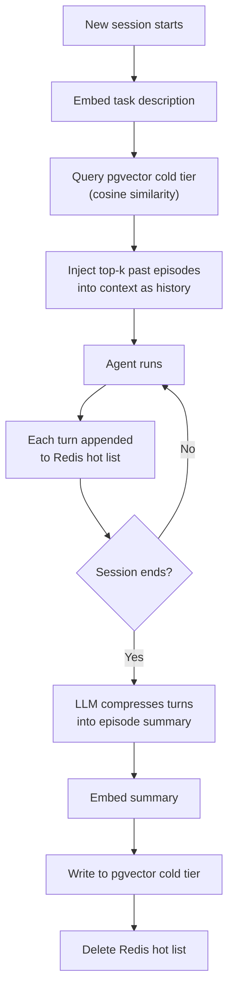

# Agent Memory Part 3: Episodic Memory

Episodic memory gives agents continuity across sessions. Where working memory tracks what is happening *now*, episodic memory answers "what happened before, and what did we learn?"

The challenge is scale: a busy agent accumulates thousands of turns across hundreds of sessions. Loading all of them into the context window is impossible. Episodic memory solves this by compressing completed sessions into searchable summaries stored in pgvector, and loading only the episodes most relevant to the current task.

---

## The Continuity Problem

Without episodic memory, each session is isolated:

- The agent re-explains context from scratch every time
- Users repeat themselves across sessions
- Prior investigations and decisions are invisible
- Recurring errors are diagnosed without history

With episodic memory, a session starts by retrieving past episodes similar to the current task, bootstrapping the agent with relevant prior experience before it has taken a single step.

---

## Hot and Cold Storage

Episodic memory uses a two-tier model:

| Tier | Storage | What it holds | Retention |
|---|---|---|---|
| **Hot** | Redis (list) | Last N turns of the current session, verbatim | Session TTL |
| **Cold** | pgvector | Compressed summaries of completed sessions, vector-indexed | Long-term |

At session end, the hot tier is compressed by an LLM into a summary, embedded, and written to the cold tier. Future sessions retrieve relevant cold episodes by semantic similarity to the incoming task.



---

## Schema

```sql
CREATE EXTENSION IF NOT EXISTS vector;

CREATE TABLE agent_episodes (
    id           UUID PRIMARY KEY DEFAULT gen_random_uuid(),
    agent_id     TEXT        NOT NULL,
    user_id      TEXT,
    team_id      TEXT,
    session_id   TEXT        NOT NULL UNIQUE,  -- one episode per session; guards against duplicate compression on retry
    summary      TEXT        NOT NULL,
    outcome      TEXT,                     -- success | failure | partial
    task_type    TEXT,                     -- incident | planning | code-review | etc.
    occurred_at  TIMESTAMPTZ NOT NULL,
    embedding    vector(1536) NOT NULL
);

CREATE INDEX ON agent_episodes USING hnsw (embedding vector_cosine_ops);
CREATE INDEX ON agent_episodes (agent_id, occurred_at DESC);
CREATE INDEX ON agent_episodes (team_id, task_type);
```

The `embedding` column holds a vector representation of the episode summary. At retrieval time, the current task description is embedded and used as the search query.

### Choosing a Vector Index

Two index types are available in pgvector. For episodic memory, **HNSW is the right default**.

| | IVFFlat | HNSW |
|---|---|---|  
| **Build requirement** | Requires training data; cannot build on an empty or near-empty table | Builds incrementally; works from row 0 |
| **Tuning** | `lists` must be set to `sqrt(row_count)` and the index rebuilt as data grows | `m` and `ef_construction` rarely need changing; no rebuild required |
| **Recall at scale** | Degrades if `lists` is not kept in sync with row count | Stable recall regardless of table size |
| **Build time** | Faster initial build | Slower initial build, but no reindexing cost later |
| **Memory** | Lower | Higher |

**IVFFlat `lists` tuning note:** if you do use IVFFlat, the recommended starting formula is `lists = sqrt(row_count)`. A fixed value of `lists = 100` is optimal for ~10,000 rows. Below ~100 rows the index cannot be built at all; above ~10,000 rows recall degrades steadily unless the index is dropped and recreated. For a system that may accumulate hundreds of thousands of episodes, this is a significant operational burden — HNSW avoids it entirely.

---

## Go Implementation

### Hot Tier: Redis Turn Buffer

```go
import (
    "context"
    "encoding/json"
    "fmt"
    "time"

    "github.com/redis/go-redis/v9"
)

type Turn struct {
    Role      string    `json:"role"`
    Content   string    `json:"content"`
    Timestamp time.Time `json:"timestamp"`
}

type EpisodicHotTier struct {
    client    *redis.Client
    sessionID string
    ttl       time.Duration
    maxTurns  int
}

func (e *EpisodicHotTier) hotKey() string {
    return fmt.Sprintf("episode:%s:turns", e.sessionID)
}

func (e *EpisodicHotTier) AppendTurn(ctx context.Context, t Turn) error {
    data, err := json.Marshal(t)
    if err != nil {
        return err
    }

    pipe := e.client.Pipeline()
    pipe.RPush(ctx, e.hotKey(), string(data))
    // Trim to the most recent maxTurns entries to bound memory usage.
    pipe.LTrim(ctx, e.hotKey(), int64(-e.maxTurns), -1)
    pipe.Expire(ctx, e.hotKey(), e.ttl)
    _, err = pipe.Exec(ctx)
    return err
}

func (e *EpisodicHotTier) GetTurns(ctx context.Context) ([]Turn, error) {
    raw, err := e.client.LRange(ctx, e.hotKey(), 0, -1).Result()
    if err != nil {
        return nil, err
    }

    turns := make([]Turn, 0, len(raw))
    for _, r := range raw {
        var t Turn
        if err := json.Unmarshal([]byte(r), &t); err != nil {
            continue // skip malformed entries
        }
        turns = append(turns, t)
    }
    return turns, nil
}

func (e *EpisodicHotTier) Delete(ctx context.Context) error {
    return e.client.Del(ctx, e.hotKey()).Err()
}
```

### Cold Tier: pgvector Episode Storage

```go
import (
    "context"
    "time"

    "github.com/google/uuid"
    "github.com/jackc/pgx/v5/pgxpool"
    "github.com/pgvector/pgvector-go"
)

type Episode struct {
    ID         uuid.UUID
    AgentID    string
    UserID     string
    TeamID     string
    SessionID  string
    Summary    string
    Outcome    string
    TaskType   string
    OccurredAt time.Time
}

type EpisodeColdTier struct {
    db       *pgxpool.Pool
    embedder EmbeddingClient
}

func (e *EpisodeColdTier) Store(ctx context.Context, ep Episode, embedding []float32) error {
    _, err := e.db.Exec(ctx, `
        INSERT INTO agent_episodes
            (agent_id, user_id, team_id, session_id, summary, outcome, task_type, occurred_at, embedding)
        VALUES ($1, $2, $3, $4, $5, $6, $7, $8, $9)
        ON CONFLICT (session_id) DO NOTHING
    `,
        ep.AgentID, ep.UserID, ep.TeamID, ep.SessionID,
        ep.Summary, ep.Outcome, ep.TaskType, ep.OccurredAt,
        pgvector.NewVector(embedding),
    )
    return err
}

// Search retrieves the most relevant past episodes for the given query embedding.
func (e *EpisodeColdTier) Search(ctx context.Context, agentID string, queryEmbedding []float32, limit int) ([]Episode, error) {
    rows, err := e.db.Query(ctx, `
        SELECT id, agent_id, user_id, team_id, session_id, summary, outcome, task_type, occurred_at
        FROM agent_episodes
        WHERE agent_id = $1
        ORDER BY embedding <=> $2
        LIMIT $3
    `, agentID, pgvector.NewVector(queryEmbedding), limit)
    if err != nil {
        return nil, err
    }
    defer rows.Close()

    var episodes []Episode
    for rows.Next() {
        var ep Episode
        if err := rows.Scan(
            &ep.ID, &ep.AgentID, &ep.UserID, &ep.TeamID,
            &ep.SessionID, &ep.Summary, &ep.Outcome,
            &ep.TaskType, &ep.OccurredAt,
        ); err != nil {
            return nil, err
        }
        episodes = append(episodes, ep)
    }
    return episodes, rows.Err()
}
```

### Session Compression

When a session ends, the hot tier is summarised and written to the cold tier. This is the highest-leverage operation in the episodic memory pipeline — the quality of the summary determines retrieval quality for all future sessions.

```go
type SessionCompressor struct {
    hot      *EpisodicHotTier
    cold     *EpisodeColdTier
    llm      LLMClient
    embedder EmbeddingClient
}

func (c *SessionCompressor) Close(ctx context.Context, meta Episode) error {
    turns, err := c.hot.GetTurns(ctx)
    if err != nil {
        return fmt.Errorf("reading hot tier: %w", err)
    }
    if len(turns) == 0 {
        return nil // nothing to compress
    }

    summary, err := c.llm.Complete(ctx, CompletionRequest{
        SystemPrompt: `Summarise this agent session in 3-5 sentences.
Include: the original task, the key steps taken, any important findings or decisions, and the final outcome.
Be specific and factual. Do not include intermediate reasoning or raw tool outputs.`,
        UserMessage: formatTranscript(turns),
    })
    if err != nil {
        return fmt.Errorf("summarising session: %w", err)
    }

    embedding, err := c.embedder.Embed(ctx, summary)
    if err != nil {
        return fmt.Errorf("embedding summary: %w", err)
    }

    meta.Summary = summary
    meta.OccurredAt = time.Now()
    if err := c.cold.Store(ctx, meta, embedding); err != nil {
        return fmt.Errorf("storing episode: %w", err)
    }

    return c.hot.Delete(ctx)
}
```

### Session Bootstrap

At the start of a new session, retrieve relevant past episodes to prime the agent with prior experience.

```go
func (c *SessionCompressor) Bootstrap(ctx context.Context, agentID, taskDescription string) ([]Episode, error) {
    embedding, err := c.embedder.Embed(ctx, taskDescription)
    if err != nil {
        return nil, fmt.Errorf("embedding task description: %w", err)
    }
    return c.cold.Search(ctx, agentID, embedding, 3)
}

// FormatAsContext renders retrieved episodes as a system message block.
func FormatAsContext(episodes []Episode) string {
    if len(episodes) == 0 {
        return ""
    }

    var sb strings.Builder
    sb.WriteString("Relevant past sessions:\n\n")
    for i, ep := range episodes {
        sb.WriteString(fmt.Sprintf(
            "%d. [%s — %s] %s\n   %s\n\n",
            i+1, ep.OccurredAt.Format("2006-01-02"), ep.Outcome, ep.TaskType, ep.Summary,
        ))
    }
    return sb.String()
}
```

---

## Compression Quality

The summary prompt is the highest-leverage tuning point in episodic memory. A poor prompt produces vague summaries that match the wrong episodes at retrieval time.

| Prompt issue | Symptom | Fix |
|---|---|---|
| Too vague ("summarise this") | Summaries lack specifics; retrieval returns near-misses | Require outcome, key decisions, and concrete findings |
| Includes reasoning traces | Summaries are verbose; token cost at retrieval rises | Explicitly exclude intermediate reasoning |
| No outcome classification | Cannot filter by success/failure in structured queries | Require an explicit outcome field |
| No task type | Retrieval mixes unrelated task kinds | Add a structured classification instruction |

Always validate compression quality against a representative sample of real sessions before deploying. Embed the summaries and manually inspect the top-k results for a few representative queries — retrieval quality is only as good as the summaries it indexes.

---

## Scoping Episode Retrieval

By default, Search retrieves episodes for a single `agent_id`. For team agents — where multiple instances of the same role share a history — query by `team_id` instead. For user-specific continuity, filter by `user_id`.

> **Known trade-off: vector index pre-filtering**
>
> The `Search` queries combine a `WHERE agent_id = $1` predicate with `ORDER BY embedding <=> $2`. pgvector ANN indexes (both IVFFlat and HNSW) do not support pre-filtering — the planner evaluates the WHERE clause *after* the index scan (post-filtering). In practice this means:
>
> - **IVFFlat** — the planner is likely to fall back to a sequential scan when selectivity is high, then sort by distance. For tables with many agents, IVFFlat gives essentially no benefit on scoped queries.
> - **HNSW** — handles post-filtering better because it explores more graph neighbours before applying the predicate, but recall can still degrade when a single `agent_id` holds a small fraction of total rows.
>
> **Mitigations for high-volume deployments:**
>
> | Approach | When to use |
> |---|---|
> | **HNSW (default, already applied)** | Acceptable for most workloads; better post-filtering recall than IVFFlat at no extra schema cost |
> | **Partial index per agent** | High-value agents with large episode counts: `CREATE INDEX ON agent_episodes USING hnsw (embedding vector_cosine_ops) WHERE agent_id = 'my-agent'` |
> | **Partition by `agent_id`** | Many agents each with very large episode histories; each partition gets its own index and the planner prunes at the partition level |

```go
// SearchByTeam retrieves episodes relevant across all agents in a team.
func (e *EpisodeColdTier) SearchByTeam(ctx context.Context, teamID string, queryEmbedding []float32, limit int) ([]Episode, error) {
    rows, err := e.db.Query(ctx, `
        SELECT id, agent_id, user_id, team_id, session_id, summary, outcome, task_type, occurred_at
        FROM agent_episodes
        WHERE team_id = $1
        ORDER BY embedding <=> $2
        LIMIT $3
    `, teamID, pgvector.NewVector(queryEmbedding), limit)
    if err != nil {
        return nil, err
    }
    defer rows.Close()

    var episodes []Episode
    for rows.Next() {
        var ep Episode
        if err := rows.Scan(
            &ep.ID, &ep.AgentID, &ep.UserID, &ep.TeamID,
            &ep.SessionID, &ep.Summary, &ep.Outcome,
            &ep.TaskType, &ep.OccurredAt,
        ); err != nil {
            return nil, err
        }
        episodes = append(episodes, ep)
    }
    return episodes, rows.Err()
}
```

---

## Putting It Together

```go
func (a *Agent) Run(ctx context.Context, task string) error {
    // 1. Bootstrap from episodic memory.
    pastEpisodes, err := a.compressor.Bootstrap(ctx, a.id, task)
    if err != nil {
        return fmt.Errorf("episodic bootstrap: %w", err)
    }
    episodicContext := FormatAsContext(pastEpisodes)

    // 2. Initialise working memory for this session.
    a.working = NewWorkingMemory(a.redis, a.sessionID, 2*time.Hour)

    // 3. Run the agent loop, passing episodic context as a system message.
    result, err := a.runLoop(ctx, task, episodicContext)
    if err != nil {
        return err
    }

    // 4. Compress this session to episodic memory for future agents.
    return a.compressor.Close(ctx, Episode{
        AgentID:   a.id,
        SessionID: a.sessionID,
        TaskType:  classifyTask(task),
        Outcome:   classifyOutcome(result),
    })
}
```

---

## What Comes Next

| Part | Topic |
|---|---|
| [Part 4: Semantic Memory](./agent-memory-semantic.md) | Long-term knowledge, embeddings, write-back, invalidation |
| [Part 5: Memory Scoping](./agent-memory-scoping.md) | Agent vs user vs team, multi-agent sharing |
