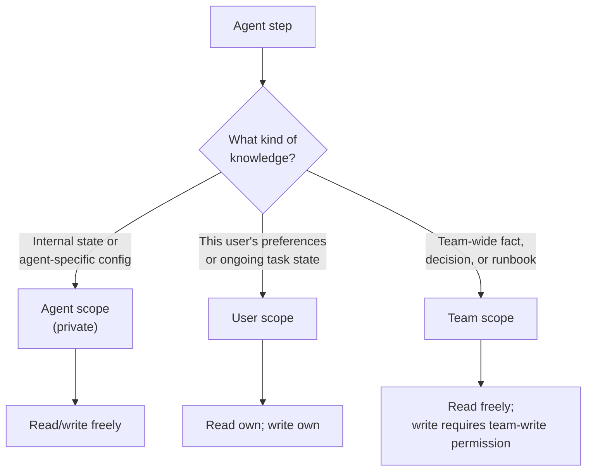
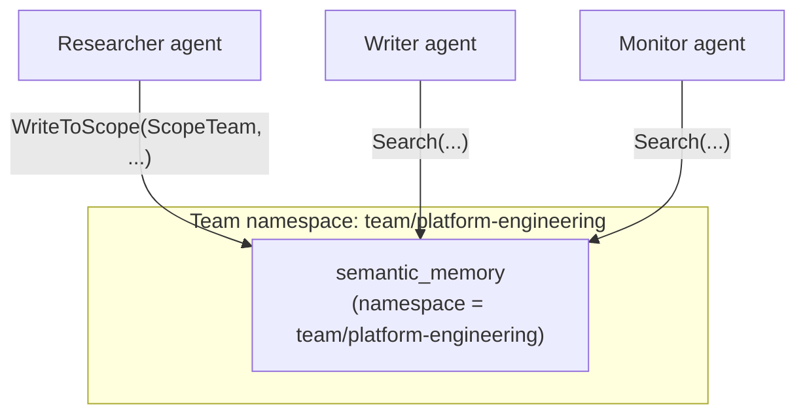
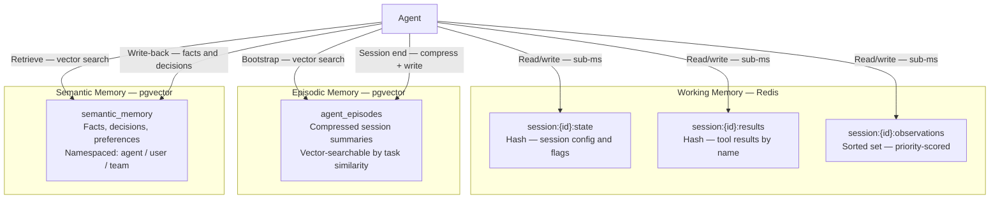

# Agent Memory Part 5: Memory Scoping and Multi-Agent Sharing

So far, memory has been treated as private to a single agent. In production systems, that is rarely sufficient. Multiple agents may serve the same team; an agent serving a user should remember that user's preferences; a platform agent's discoveries should be available to all teams without each agent rediscovering the same knowledge independently.

Memory scoping defines *who owns memory*, *who can read it*, and *how long it lives*.

---

## Three Scopes

| Scope | Who owns it | Who reads it | Typical use |
|---|---|---|---|
| **Agent** | One agent identity | That agent only | Internal state, agent-specific config, private reasoning artefacts |
| **User** | One authenticated user | Agents acting on behalf of that user | Preferences, ongoing tasks, interaction history |
| **Team** | A team namespace | All agents within that team | Shared decisions, domain knowledge, runbooks, discovered facts |

These compose. An agent running on behalf of a user, inside a team, should read from all three scopes and write to the appropriate scope based on the nature of the knowledge.



---

## Namespace Design

Both Redis and pgvector use the same namespace pattern. A namespace is a structured string that encodes scope and owner:

```
{scope}/{owner-id}/{optional-subpath}

Examples:
  agent/incident-responder-v2/state
  user/u-99a1b2/preferences
  team/platform-engineering/decisions
  team/platform-engineering/runbooks/payment
```

For working memory (Redis), namespacing is applied as a key prefix. For episodic and semantic memory (pgvector), it is a `namespace` column that participates in every query.

---

## Go Implementation

### Namespace Manager

```go
import (
    "context"
    "crypto/md5"
    "database/sql"
    "errors"
    "fmt"

    "github.com/redis/go-redis/v9"
    "github.com/jackc/pgx/v5/pgxpool"
    "github.com/pgvector/pgvector-go"
)

type Scope string

const (
    ScopeAgent Scope = "agent"
    ScopeUser  Scope = "user"
    ScopeTeam  Scope = "team"
)

type MemoryNamespace struct {
    Scope   Scope
    OwnerID string
    SubPath string
}

func (n MemoryNamespace) String() string {
    if n.SubPath != "" {
        return fmt.Sprintf("%s/%s/%s", n.Scope, n.OwnerID, n.SubPath)
    }
    return fmt.Sprintf("%s/%s", n.Scope, n.OwnerID)
}

// ResolveReadNamespaces returns the namespaces an agent should read from,
// in priority order: agent-private first, then user, then team.
func ResolveReadNamespaces(agentID, userID, teamID string) []MemoryNamespace {
    ns := []MemoryNamespace{
        {Scope: ScopeAgent, OwnerID: agentID},
    }
    if userID != "" {
        ns = append(ns, MemoryNamespace{Scope: ScopeUser, OwnerID: userID})
    }
    if teamID != "" {
        ns = append(ns, MemoryNamespace{Scope: ScopeTeam, OwnerID: teamID})
    }
    return ns
}
```

### Scoped Working Memory (Redis)

```go
type ScopedWorkingMemory struct {
    client    *redis.Client
    namespace MemoryNamespace
    sessionID string
    ttl       time.Duration
}

func (s *ScopedWorkingMemory) key(subkey string) string {
    return fmt.Sprintf("%s:session:%s:%s", s.namespace, s.sessionID, subkey)
}

func (s *ScopedWorkingMemory) Set(ctx context.Context, key, value string) error {
    return s.client.Set(ctx, s.key(key), value, s.ttl).Err()
}

func (s *ScopedWorkingMemory) Get(ctx context.Context, key string) (string, error) {
    val, err := s.client.Get(ctx, s.key(key)).Result()
    if errors.Is(err, redis.Nil) {
        return "", nil
    }
    return val, err
}

// CrossRead reads a key written by a different agent within the same session.
// Used for blackboard-style coordination: one agent reads another's output.
func (s *ScopedWorkingMemory) CrossRead(ctx context.Context, otherAgentID, key string) (string, error) {
    crossNS := MemoryNamespace{Scope: ScopeAgent, OwnerID: otherAgentID}
    crossKey := fmt.Sprintf("%s:session:%s:%s", crossNS, s.sessionID, key)
    val, err := s.client.Get(ctx, crossKey).Result()
    if errors.Is(err, redis.Nil) {
        return "", nil
    }
    return val, err
}
```

### Scoped Semantic Memory (pgvector)

The `namespace` column in `semantic_memory` supports scoping natively. The scoped layer wraps the read path to query across all applicable namespaces in a single round-trip.

```go
type ScopedSemanticMemory struct {
    base       *SemanticMemory
    namespaces []MemoryNamespace // ordered: agent → user → team
}

func NewScopedSemanticMemory(base *SemanticMemory, agentID, userID, teamID string) *ScopedSemanticMemory {
    return &ScopedSemanticMemory{
        base:       base,
        namespaces: ResolveReadNamespaces(agentID, userID, teamID),
    }
}

// Search queries all applicable namespaces and returns merged, deduplicated results.
func (s *ScopedSemanticMemory) Search(ctx context.Context, query, kind string, limit int) ([]MemoryRecord, error) {
    embedding, err := s.base.embedder.Embed(ctx, query)
    if err != nil {
        return nil, fmt.Errorf("embedding query: %w", err)
    }

    nsStrings := make([]string, len(s.namespaces))
    for i, ns := range s.namespaces {
        nsStrings[i] = ns.String()
    }

    args := []any{nsStrings, pgvector.NewVector(embedding), limit}
    kindFilter := ""
    if kind != "" {
        args = append(args, kind)
        kindFilter = fmt.Sprintf("AND kind = $%d", len(args))
    }

    rows, err := s.base.db.Query(ctx, fmt.Sprintf(`
        SELECT id, namespace, key, content, kind, source, confidence, stored_at, expires_at
        FROM semantic_memory
        WHERE namespace = ANY($1)
          AND superseded = FALSE
          AND (expires_at IS NULL OR expires_at > now())
          %s
        ORDER BY embedding <=> $2
        LIMIT $3
    `, kindFilter), args...)
    if err != nil {
        return nil, err
    }
    defer rows.Close()

    var records []MemoryRecord
    seen := map[[16]byte]struct{}{}
    for rows.Next() {
        var rec MemoryRecord
        var key sql.NullString
        var expiresAt sql.NullTime
        if err := rows.Scan(
            &rec.ID, &rec.Namespace, &key, &rec.Content,
            &rec.Kind, &rec.Source, &rec.Confidence,
            &rec.StoredAt, &expiresAt,
        ); err != nil {
            return nil, err
        }
        rec.Key = key.String
        if expiresAt.Valid {
            rec.ExpiresAt = &expiresAt.Time
        }
        // Deduplicate by content fingerprint so that the same fact
        // stored in multiple scopes appears only once.
        fp := md5.Sum([]byte(rec.Content))
        if _, dup := seen[fp]; !dup {
            seen[fp] = struct{}{}
            records = append(records, rec)
        }
    }
    return records, rows.Err()
}

// WriteToScope writes to a specific scope rather than the agent-default.
func (s *ScopedSemanticMemory) WriteToScope(ctx context.Context, scope Scope, ownerID string, rec MemoryRecord) error {
    rec.Namespace = MemoryNamespace{Scope: scope, OwnerID: ownerID}.String()
    return s.base.Write(ctx, rec)
}
```

---

## Multi-Agent Sharing

When multiple agents collaborate — an orchestrator delegating to specialists — they need to share findings without coupling their internal states. Two patterns work well with the scoping model.

### Blackboard (team scope)

All agents in a team write discoveries to the shared team namespace. Any agent can read. No explicit handoff message is required.



```go
// ResearcherAgent writes its findings to the team scope.
func (r *ResearcherAgent) storeFindings(ctx context.Context, key, content string) error {
    return r.memory.WriteToScope(ctx, ScopeTeam, r.teamID, MemoryRecord{
        Key:     key,
        Content: content,
        Kind:    "fact",
        Source:  fmt.Sprintf("agent/%s", r.id),
    })
}

// WriterAgent retrieves findings from the team scope transparently —
// the scoped search includes the team namespace automatically.
func (w *WriterAgent) loadFindings(ctx context.Context, topic string) ([]MemoryRecord, error) {
    return w.memory.Search(ctx, topic, "fact", 5)
}
```

### Message-Passing (structured handoff)

The orchestrator explicitly packages relevant memory into the handoff payload. The receiving agent loads only what is handed to it.

```go
type Handoff struct {
    Task     string         `json:"task"`
    Context  string         `json:"context"`
    Findings []MemoryRecord `json:"findings"`
}

func (o *Orchestrator) handoffToWriter(ctx context.Context, task string) (*Handoff, error) {
    findings, err := o.memory.Search(ctx, task, "fact", 10)
    if err != nil {
        return nil, fmt.Errorf("building handoff: %w", err)
    }
    return &Handoff{
        Task:     task,
        Context:  o.sessionContext,
        Findings: findings,
    }, nil
}
```

---

## Choosing a Sharing Model

| Consideration | Blackboard | Message-passing |
|---|---|---|
| Agent coupling | Low — agents don't need to know each other | Medium — orchestrator shapes each handoff |
| Write contention | Possible with many concurrent writers | None — isolated handoff payloads |
| Observability | Simple — query the shared store | Requires handoff logging |
| Best for | Loosely coupled specialist swarms | Orchestrator / worker pipelines |
| Worst for | High-throughput concurrent writes | Ad-hoc collaboration without a coordinator |

---

## Full Memory Architecture



---

## Putting It Together

```go
type AgentConfig struct {
    AgentID   string
    UserID    string
    TeamID    string
    SessionID string
}

func NewAgent(cfg AgentConfig, redisClient *redis.Client, db *pgxpool.Pool, embedder EmbeddingClient) *Agent {
    base := &SemanticMemory{db: db, embedder: embedder}
    scoped := NewScopedSemanticMemory(base, cfg.AgentID, cfg.UserID, cfg.TeamID)

    return &Agent{
        id:      cfg.AgentID,
        teamID:  cfg.TeamID,
        working: NewWorkingMemory(redisClient, cfg.SessionID, 2*time.Hour),
        semantic: scoped,
        compressor: NewSessionCompressor(
            &EpisodicHotTier{client: redisClient, sessionID: cfg.SessionID, ttl: 2 * time.Hour, maxTurns: 100},
            &EpisodeColdTier{db: db, embedder: embedder},
            llmClient,
            embedder,
        ),
    }
}

// The agent reads user preferences transparently — the scoped search
// resolves agent, user, and team namespaces in a single query.
func (a *Agent) loadUserPreferences(ctx context.Context) (string, error) {
    prefs, err := a.semantic.Search(ctx, "user communication style and preferences", "preference", 3)
    if err != nil {
        return "", err
    }
    return formatRecords(prefs), nil
}
```

---

## Related Reading

- [Part 2: Working Memory](./agent-memory-working.md) — Redis session state and eviction
- [Part 3: Episodic Memory](./agent-memory-episodic.md) — Session history and pgvector compression
- [Part 4: Semantic Memory](./agent-memory-semantic.md) — Long-term knowledge and write-back
- [Agentic Patterns Part 5: Memory](../agentic-patterns/agentic-patterns-memory.md) — Pattern-level design decisions
- [Context Engineering](../context-engineering/context-engineering.md) — Managing what enters the context window
- [Agent Runtime](../agent-runtime/readme.md) — Deploying agents with memory dependencies wired
