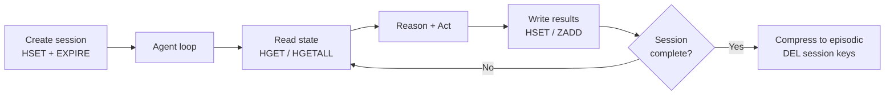

# Agent Memory Part 2: Working Memory

Working memory is the agent's scratchpad for a single session. It holds tool results, intermediate state, session configuration, and the priority-scored observations an agent accumulates while running — without injecting all of it into the context window at once.

Redis is the right backing store: sub-millisecond reads, native TTL-based expiry, and data structures that match the access patterns agents actually need.

---

## What Working Memory Holds

Working memory is not just conversation history. A typical agent session accumulates:

- **Tool results** — API responses, database records, computed values from prior steps
- **Intermediate state** — a partially-built plan, a list of items still to process
- **Session configuration** — which user, which tenant, which environment
- **Flags and decisions** — "we already checked this resource", "user approved this step"
- **Error state** — which tools failed, which have been retried

None of this needs to be in the context window simultaneously. The agent reads what it needs *right now*, acts, and writes what it learned back to working memory.

---

## Redis Data Structures

| Use case | Redis structure | Key pattern | Notes |
|---|---|---|---|
| Session state | Hash | `session:{id}:state` | One field per state variable |
| Tool results | Hash | `session:{id}:results` | Keyed by tool name |
| Priority-scored observations | Sorted set | `session:{id}:observations` | Score = priority; ZREVRANGE for top-k |
| Ordered message history | List | `session:{id}:messages` | RPUSH append; LRANGE read |

All keys carry a TTL. A session that is never explicitly closed will expire automatically.

---

## Session Lifecycle



---

## Go Implementation

### Session Store

```go
import (
    "context"
    "encoding/json"
    "errors"
    "fmt"
    "time"

    "github.com/redis/go-redis/v9"
)

type WorkingMemory struct {
    client    *redis.Client
    sessionID string
    ttl       time.Duration
}

func NewWorkingMemory(client *redis.Client, sessionID string, ttl time.Duration) *WorkingMemory {
    return &WorkingMemory{
        client:    client,
        sessionID: sessionID,
        ttl:       ttl,
    }
}

func (w *WorkingMemory) stateKey() string {
    return fmt.Sprintf("session:%s:state", w.sessionID)
}

func (w *WorkingMemory) resultsKey() string {
    return fmt.Sprintf("session:%s:results", w.sessionID)
}

func (w *WorkingMemory) observationsKey() string {
    return fmt.Sprintf("session:%s:observations", w.sessionID)
}
```

### Reading and Writing State

```go
func (w *WorkingMemory) SetState(ctx context.Context, key, value string) error {
    pipe := w.client.Pipeline()
    pipe.HSet(ctx, w.stateKey(), key, value)
    pipe.Expire(ctx, w.stateKey(), w.ttl)
    _, err := pipe.Exec(ctx)
    return err
}

func (w *WorkingMemory) GetState(ctx context.Context, key string) (string, error) {
    val, err := w.client.HGet(ctx, w.stateKey(), key).Result()
    if errors.Is(err, redis.Nil) {
        return "", nil // key not present — treat as empty, not an error
    }
    return val, err
}

func (w *WorkingMemory) AllState(ctx context.Context) (map[string]string, error) {
    return w.client.HGetAll(ctx, w.stateKey()).Result()
}
```

### Storing Tool Results

```go
func (w *WorkingMemory) StoreResult(ctx context.Context, toolName, result string) error {
    pipe := w.client.Pipeline()
    pipe.HSet(ctx, w.resultsKey(), toolName, result)
    pipe.Expire(ctx, w.resultsKey(), w.ttl)
    _, err := pipe.Exec(ctx)
    return err
}

func (w *WorkingMemory) GetResult(ctx context.Context, toolName string) (string, bool, error) {
    val, err := w.client.HGet(ctx, w.resultsKey(), toolName).Result()
    if errors.Is(err, redis.Nil) {
        return "", false, nil
    }
    if err != nil {
        return "", false, err
    }
    return val, true, nil
}
```

### Priority-Scored Observations

Not all observations are equally important. An agent that discovers a critical constraint should retain that observation even when older, lower-value observations are dropped to free context budget.

```go
type Observation struct {
    Content   string    `json:"content"`
    Source    string    `json:"source"`    // which tool produced this
    Timestamp time.Time `json:"timestamp"`
}

func (w *WorkingMemory) AddObservation(ctx context.Context, obs Observation, priority float64) error {
    data, err := json.Marshal(obs)
    if err != nil {
        return err
    }

    pipe := w.client.Pipeline()
    pipe.ZAdd(ctx, w.observationsKey(), redis.Z{
        Score:  priority,
        Member: string(data),
    })
    pipe.Expire(ctx, w.observationsKey(), w.ttl)
    _, err = pipe.Exec(ctx)
    return err
}

// TopObservations returns the highest-priority observations up to the given limit.
func (w *WorkingMemory) TopObservations(ctx context.Context, limit int) ([]Observation, error) {
    // ZREVRANGE returns members sorted high-to-low by score.
    results, err := w.client.ZRevRange(ctx, w.observationsKey(), 0, int64(limit-1)).Result()
    if err != nil {
        return nil, err
    }

    observations := make([]Observation, 0, len(results))
    for _, r := range results {
        var obs Observation
        if err := json.Unmarshal([]byte(r), &obs); err != nil {
            continue // skip malformed entries
        }
        observations = append(observations, obs)
    }
    return observations, nil
}
```

### Syncing Working Memory into Context

Working memory is only useful if the agent can load the right subset into the context window when needed. Loading everything defeats the purpose; loading nothing leaves the agent blind.

```go
type ContextLoader struct {
    memory       *WorkingMemory
    maxTokens    int
    tokenCounter func(string) int
}

// BuildContextSlice returns a minimal set of working memory entries
// that fit within the token budget, ordered by priority.
func (c *ContextLoader) BuildContextSlice(ctx context.Context) ([]string, error) {
    var entries []string
    used := 0

    // Always include session state — it is small and always relevant.
    state, err := c.memory.AllState(ctx)
    if err != nil {
        return nil, err
    }
    for k, v := range state {
        entry := fmt.Sprintf("%s: %s", k, v)
        cost := c.tokenCounter(entry)
        if used+cost > c.maxTokens {
            break
        }
        entries = append(entries, entry)
        used += cost
    }

    // Fill remaining budget with highest-priority observations.
    obs, err := c.memory.TopObservations(ctx, 20)
    if err != nil {
        return nil, err
    }
    for _, o := range obs {
        cost := c.tokenCounter(o.Content)
        if used+cost > c.maxTokens {
            break
        }
        entries = append(entries, o.Content)
        used += cost
    }

    return entries, nil
}
```

---

## TTL Strategy

| Memory class | Suggested TTL | Reasoning |
|---|---|---|
| Interactive chat session | 2 hours | Matches typical user engagement window |
| Background agent job | Job timeout + 10 minutes | State needed only while the job runs |
| Async multi-step workflow | 24 hours | Steps may be hours apart |
| Shared coordination state | 48 hours | Accommodates multi-timezone handoffs |

Set TTL on every write. Use Redis pipelines to set value and extend TTL atomically in one round-trip.

---

## Putting It Together

A working memory-aware step inside a ReAct agent loop. The result cache check avoids redundant tool calls when the agent revisits a question it has already answered.

```go
func (a *Agent) step(ctx context.Context, toolName string, params map[string]any) (string, error) {
    // Check if we already have this result cached in working memory.
    if result, ok, err := a.memory.GetResult(ctx, toolName); err != nil {
        return "", fmt.Errorf("reading working memory: %w", err)
    } else if ok {
        return result, nil // cache hit — skip the tool call
    }

    // Execute the tool.
    result, err := a.tools.Execute(ctx, toolName, params)
    if err != nil {
        return "", fmt.Errorf("executing %s: %w", toolName, err)
    }

    // Store result and record as a scored observation.
    if err := a.memory.StoreResult(ctx, toolName, result); err != nil {
        return "", fmt.Errorf("storing result: %w", err)
    }

    obs := Observation{
        Content:   result,
        Source:    toolName,
        Timestamp: time.Now(),
    }
    if err := a.memory.AddObservation(ctx, obs, a.scorePriority(result)); err != nil {
        return "", fmt.Errorf("recording observation: %w", err)
    }

    return result, nil
}
```

---

## What Comes Next

| Part | Topic |
|---|---|
| [Part 3: Episodic Memory](./agent-memory-episodic.md) | Session history, compression, pgvector storage |
| [Part 4: Semantic Memory](./agent-memory-semantic.md) | Long-term knowledge, embeddings, write-back |
| [Part 5: Memory Scoping](./agent-memory-scoping.md) | Agent vs user vs team, multi-agent sharing |
