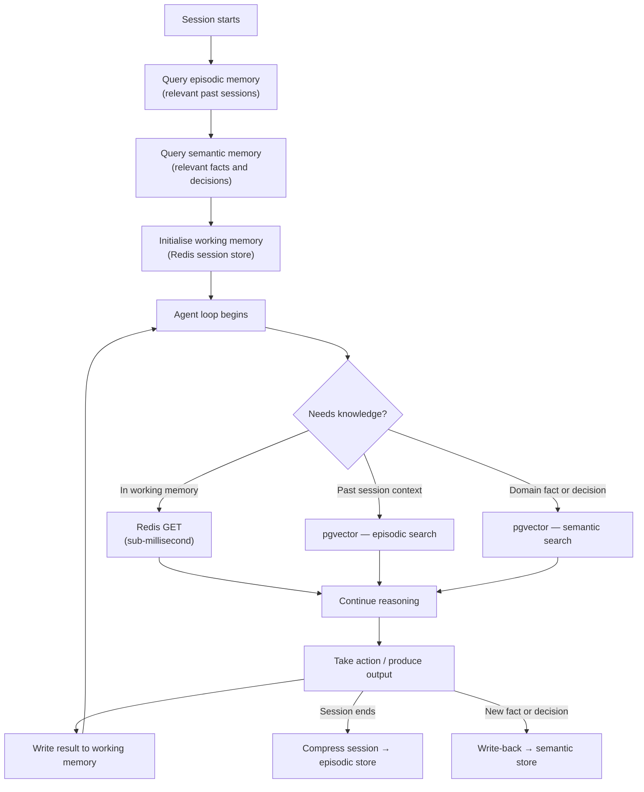

# Agent Memory

An agent that cannot remember is forced to rediscover the same facts on every run. Memory transforms a stateless request-processor into a system that accumulates knowledge, maintains continuity across sessions, and shares context with collaborators.

This series covers the full memory stack: how to design it, implement it in Go, and choose the right scope for production agents.

---

## Why Memory Matters

Context engineering controls what an agent knows *right now*. Memory controls what an agent knows *over time*.

Without memory:

- Every session starts from zero — the agent re-fetches the same data and re-reasons the same conclusions
- Long conversations exhaust the context window and lose early reasoning
- Multi-agent systems cannot build on each other's work
- User preferences, prior decisions, and accumulated findings evaporate between runs

Memory is not a luxury. For production agents doing real work, it is load-bearing infrastructure.

---

## Three Memory Types

Agents operate with three distinct memory types. Each has a different lifetime, storage technology, and access cost.

| Type | Lifetime | Technology | Access cost | Primary use |
|---|---|---|---|---|
| **Working** | One session | Redis | Sub-millisecond | Active session state, tool results, pending actions |
| **Episodic** | Across sessions | pgvector | Low (vector search) | Compressed history of past sessions |
| **Semantic** | Permanent | pgvector | Low (vector search) | Accumulated facts, decisions, domain knowledge |

These are not mutually exclusive. A running agent uses all three simultaneously.

---

## How They Compose

At session start, an agent bootstraps from episodic and semantic memory. During the session, working memory accumulates observations. At session end, the session is compressed back into episodic memory and important findings are written to semantic memory.

The agent loop maps directly onto memory:

| Loop phase | Memory involvement |
|---|---|
| **Perceive** | Load episodic context; retrieve semantic facts relevant to the incoming task |
| **Reason** | Read from working memory; retrieve additional knowledge on demand |
| **Act** | Execute tools; results land in working memory |
| **Observe** | Update working memory with observations; flag important findings for write-back |

---

## Technology Choices

**Redis** backs working memory. It is fast enough that a memory read never becomes a bottleneck, supports TTL-based expiry natively, and provides the right data structures: hashes for session state, sorted sets for priority-ordered observations, lists for ordered message history.

**pgvector** backs both episodic and semantic memory. Storing vectors alongside relational metadata in PostgreSQL means you get semantic similarity search and structured filtering in a single query — without a separate vector database to operate.

Both are standard platform services with established operational patterns.

---

## Relationship to Existing Series

This series builds on two prior foundations:

**Context Engineering** covers the token budget and how to structure what enters the context window. Working memory feeds context; this series explains what lives *outside* the window and how it gets in.

**Agentic Patterns Part 5** covers memory at the *design* level: the three types, their trade-offs, and the patterns for using them. This series covers *implementation*: concrete Go code, real storage backends, and production concerns like scoping, invalidation, and multi-agent sharing.

---

## Choosing the Right Memory Type

| Situation | Recommended memory |
|---|---|
| Tool result needed 3 steps later in the same session | Working (Redis) |
| User's name and communication preferences, set last week | Semantic (pgvector) |
| What went wrong in a similar incident two months ago | Episodic (pgvector) |
| Intermediate plan steps while executing a workflow | Working (Redis) |
| Architecture decision made last quarter | Semantic (pgvector) |
| The first 40 turns of today's long conversation | Episodic (pgvector) |
| A live API response fetched 2 steps ago | Working (Redis) |

When in doubt: **if it must survive a process restart, it needs persistent storage**. If it only needs to survive the session, Redis with a TTL is sufficient.

---

## What Comes Next

| Part | Topic |
|---|---|
| [Part 2: Working Memory](./agent-memory-working.md) | Redis-backed session state, eviction, in-context sync |
| [Part 3: Episodic Memory](./agent-memory-episodic.md) | Session history, compression, pgvector storage |
| [Part 4: Semantic Memory](./agent-memory-semantic.md) | Long-term knowledge, embeddings, write-back, invalidation |
| [Part 5: Memory Scoping](./agent-memory-scoping.md) | Agent vs user vs team, namespacing, multi-agent sharing |
