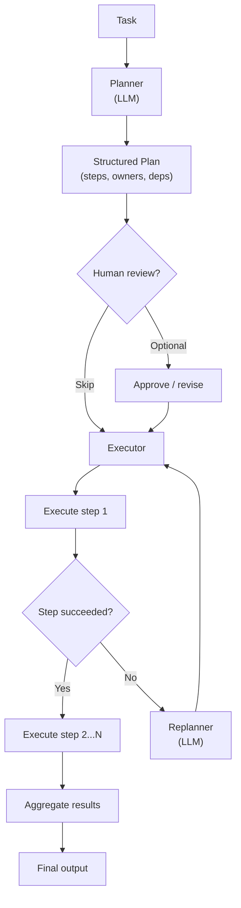
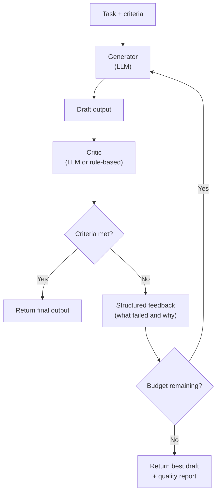

# Agentic Design Patterns Part 2: Core Loops

The three core loop patterns — ReAct, Plan-Execute, and Reflection — are the building blocks every other agentic pattern is composed from. Most agents are one of these, or a combination.

---

## ReAct (Reason + Act)

ReAct is the fundamental tool-using loop. The agent alternates between explicit reasoning steps (Thought) and actions (Action), incorporating the result of each action (Observation) before deciding what to do next.

### Structure

```
Thought:     I need to find the current on-call owner for the payments service.
Action:      call_tool("get_oncall", {"team": "payments"})
Observation: {"owner": "alice@example.com", "rotation": "weekly"}

Thought:     I have the owner. Now I need to check if there is an active incident.
Action:      call_tool("list_incidents", {"service": "payments", "status": "open"})
Observation: []

Thought:     No active incidents. I can proceed with the deployment notice.
Action:      call_tool("send_notification", {"to": "alice@example.com", "body": "..."})
Observation: {"sent": true}

Thought:     Done.
Answer:      Deployment notice sent to alice@example.com. No active incidents found.
```

The explicit Thought step is not decoration — it forces the model to reason about the result before acting again, which dramatically reduces errors on multi-step tasks.

The Thought step works by eliciting **chain-of-thought** (CoT) reasoning: asking the model to externalise its reasoning before committing to an action. CoT is a prompting technique, not an agentic pattern — it operates within a single LLM call. ReAct is what happens when you combine CoT with a tool-use loop. If you encounter references to CoT or "think step by step" prompting elsewhere, that is the mechanism this Thought step is built on. The [context engineering series](../context-engineering/context-engineering.md) covers CoT and related prompting techniques in depth.

### When to use ReAct

- The task requires tool calls interleaved with reasoning
- The number of steps is not known in advance
- Tool results may change the direction of the task
- Simplest capable pattern is preferred

### When ReAct is not enough

- The task has a long fixed sequence of steps that benefit from upfront planning
- You need a human to review the plan before any action is taken
- Output quality requires self-evaluation before returning a result

### Go Implementation

```go
type Thought struct {
    Text   string
    Action *ToolCall // nil if this is the final thought
}

type ToolCall struct {
    Name   string
    Params map[string]any
}

type ToolResult struct {
    Name   string
    Output string
    Err    error
}

type ReActAgent struct {
    llm      LLMClient
    tools    ToolRegistry
    maxSteps int
}

func (a *ReActAgent) Run(ctx context.Context, task string) (string, error) {
    history := []Message{{Role: "user", Content: task}}

    for step := range a.maxSteps {
        thought, err := a.llm.Think(ctx, history)
        if err != nil {
            return "", fmt.Errorf("step %d: %w", step, err)
        }

        // No tool call means the agent has reached a conclusion.
        if thought.Action == nil {
            return thought.Text, nil
        }

        result := a.tools.Execute(ctx, *thought.Action)

        history = append(history,
            Message{Role: "assistant", Content: formatThought(thought)},
            Message{Role: "tool", Content: formatResult(result)},
        )
    }

    return "", errors.New("max steps reached without conclusion")
}
```

---

## Plan-Execute

Plan-Execute separates thinking from doing. A planner produces a structured, reviewable plan. An executor carries out each step. The two phases are distinct and can be run by different models.

### Structure



### When to use Plan-Execute

- The task has a clear sequence of steps that can be determined upfront
- Human review of the plan is required before execution begins
- Steps are expensive (time or cost) and should not be retried speculatively
- The executor is not an LLM (a script, a workflow engine, a human team)

### When Plan-Execute is not enough

- The task is exploratory and the next step depends on what is discovered
- The plan space is too large to enumerate upfront (use ReAct instead)
- The plan is very short — overhead is not justified

### Go Implementation

```go
type Plan struct {
    Goal  string
    Steps []PlanStep
}

type PlanStep struct {
    ID          string
    Description string
    Tool        string
    Params      map[string]any
    DependsOn   []string
}

type ExecutionResult struct {
    StepID string
    Output string
    Err    error
}

type PlanExecuteAgent struct {
    planner  LLMClient
    executor StepExecutor
}

func (a *PlanExecuteAgent) Run(ctx context.Context, task string) ([]ExecutionResult, error) {
    plan, err := a.planner.GeneratePlan(ctx, task)
    if err != nil {
        return nil, fmt.Errorf("planning: %w", err)
    }

    results := make([]ExecutionResult, 0, len(plan.Steps))
    completed := map[string]string{} // stepID → output

    for i := 0; i < len(plan.Steps); i++ {
        step := plan.Steps[i]

        if err := waitForDependencies(step.DependsOn, completed); err != nil {
            return results, fmt.Errorf("step %s: dependency failed: %w", step.ID, err)
        }

        result, err := a.executor.Execute(ctx, step, completed)
        if err != nil {
            // Attempt replanning for the remaining steps.
            revised, replannErr := a.planner.Replan(ctx, plan, step.ID, err)
            if replannErr != nil {
                return results, fmt.Errorf("step %s failed and replanning failed: %w", step.ID, err)
            }
            plan = revised
            i = 0
            continue
        }

        results = append(results, result)
        completed[step.ID] = result.Output
    }

    return results, nil
}
```

---

## Reflection

Reflection adds a quality gate. A generator produces output. A critic evaluates it against explicit criteria. The generator revises. The loop runs until quality criteria are met or a budget is exhausted.

### Structure



### Critic quality

The critic is only as good as its criteria. Vague criteria ("make it better") produce vague feedback and slow convergence. Explicit, testable criteria produce fast, targeted revisions.

Good criteria are:
- **Specific:** "The plan must include a rollback step for each database migration."
- **Verifiable:** "All referenced Jira issue keys must follow the pattern [A-Z]+-[0-9]+."
- **Prioritised:** Distinguish blocking failures from warnings.

### When to use Reflection

- Output quality has high variance and incorrect outputs are costly
- Quality criteria can be stated explicitly
- Latency budget allows multiple LLM calls
- Examples: code generation, security policy review, technical writing

### When Reflection is not enough

- Quality criteria cannot be stated explicitly — use human review instead
- Latency matters more than quality — accept the first draft
- The critic is the same model with no additional context — it will not catch its own blind spots (use a different model or rule-based checks for critical criteria)

### Go Implementation

```go
type QualityCriteria struct {
    MustPass   []CriterionFn // blocking: revision required if any fail
    ShouldPass []CriterionFn // advisory: included in feedback but not blocking
}

type CriterionFn func(output string) (pass bool, feedback string)

type ReflectionAgent struct {
    generator LLMClient
    critic    LLMClient
    criteria  QualityCriteria
    maxRounds int
}

type QualityReport struct {
    Passed    []string
    Failed    []string
    Warnings  []string
    Rounds    int
}

func (a *ReflectionAgent) Run(ctx context.Context, task string) (string, QualityReport, error) {
    report := QualityReport{}
    draft := ""

    // Tracks the failures from the previous round to pass to the generator.
    // Kept separate from report so the generator input and the live report fields
    // do not alias — report fields are always reset by a.criteria.Evaluate each round.
    var generatorFeedback []string

    for round := range a.maxRounds {
        report.Rounds = round + 1

        var err error
        draft, err = a.generator.Generate(ctx, task, draft, generatorFeedback)
        if err != nil {
            return "", report, fmt.Errorf("generation round %d: %w", round, err)
        }

        // Apply deterministic criteria first — fast and cheap.
        // Evaluate replaces (not appends to) all three fields, so report always
        // reflects only the current draft.
        report.Passed, report.Failed, report.Warnings = a.criteria.Evaluate(draft)
        if len(report.Failed) == 0 {
            return draft, report, nil
        }

        // Use the critic LLM for nuanced feedback when deterministic checks fail.
        if round < a.maxRounds-1 {
            feedback, err := a.critic.Critique(ctx, task, draft, report)
            if err != nil {
                return draft, report, fmt.Errorf("critique round %d: %w", round, err)
            }
            report.Failed = append(report.Failed, feedback.BlockingIssues...)
            report.Warnings = append(report.Warnings, feedback.AdvisoryIssues...)
        }

        // Snapshot the combined failures so the generator receives full context
        // from this round when it produces the next draft.
        generatorFeedback = report.Failed
    }

    // Return best effort draft with quality report.
    return draft, report, nil
}
```

---

## Composing the Three Patterns

These patterns are not mutually exclusive.

| Combination | When to use |
|---|---|
| ReAct + Reflection | Tool-using task where output quality matters (e.g. code generation with tests) |
| Plan-Execute + Reflection | Multi-step delivery plan that must meet explicit quality criteria before handoff |
| Plan-Execute + ReAct | Planning phase produces steps; each step is executed by a ReAct agent |
| All three | High-stakes, multi-step, quality-sensitive automation (use sparingly — high cost) |

The rule: add a pattern only when the simpler form demonstrably cannot meet the requirement. Unnecessary complexity increases latency, cost, and failure modes.

---

## Cost-Aware Loop Design

Cost should be treated as a first-class loop budget, like latency and reliability.

The practical model is two-layered:

- **Routing heuristic (primary):** choose the cheapest sufficient strategy for the current step.
- **Hard guardrails (safety):** enforce non-negotiable ceilings and fallback behavior.

### Step-level routing heuristic

Before each reasoning step, classify the work:

- Task complexity (low/medium/high)
- Risk tier (low/medium/high/critical)
- Reversibility (easy/hard)
- Tool confidence (high when deterministic tool path exists)
- Remaining budget (per-step and per-run)

Then route accordingly:

- Low complexity + high tool confidence: tool-first + small model for synthesis.
- Medium complexity: standard model with bounded iteration.
- High complexity or high-risk: stronger model, with explicit HITL checkpoints.

This avoids paying premium model cost for routine actions while preserving quality where it matters.

### Why not hard cap alone

A strict per-call cap without routing typically causes avoidable failures:

- Expensive-but-correct calls are blocked even when they minimize total task cost.
- Forced downgrades can increase retries and rework.
- Loop-level spend remains uncontrolled if many cheap calls accumulate.

### Why not heuristic alone

Heuristics drift and fail in edge cases. Hard ceilings prevent runaway spend when prompt growth, retries, or loops behave unexpectedly.

### Loop budget policies

Every loop should define and enforce:

- Maximum USD per step
- Maximum USD per run
- Maximum rounds/iterations
- Maximum retries per step

When a threshold is crossed, apply a deterministic fallback ladder:

1. Trim context and remove non-critical memory/tool traces.
2. Reduce loop depth (for example, fewer reflection rounds).
3. Route to a cheaper model.
4. Switch to tool-only or partial-result mode when possible.
5. Escalate to human review for high-impact unresolved tasks.

### Reflection-specific guidance

Reflection can improve quality but is a common cost amplifier. Default to bounded reflection:

- Start with deterministic checks first (cheap).
- Use one critique pass by default.
- Allow additional rounds only when quality criteria are blocking and budget remains.

### What to optimize

Optimize for **expected total task cost**, not just unit cost per LLM call. A more expensive model can be cheaper end-to-end if it reduces retries, invalid tool actions, and human rework.

## What Comes Next

- [Part 3: Prompt Chaining](agentic-patterns-prompt-chaining.md) — Linear chains, gates, routing, and when not to use a full agent loop
- [Part 4: Multi-Agent Patterns](agentic-patterns-multi-agent.md) — Orchestrator/Worker, parallel, pipeline
- [Part 5: Memory](agentic-patterns-memory.md) — In-context, external, and episodic memory; write-back; shared memory
- [Part 6: Tool Use](agentic-patterns-tool-use.md) — Tool design, error handling, parallel calling, caching, and MCP
- [Part 7: Human-in-the-Loop](agentic-patterns-human-in-the-loop.md) — Approval gates, checkpoints, escalation
- [Part 8: Maersk Lens](agentic-patterns-maersk-lens.md) — Applying patterns to Maersk systems and tooling
