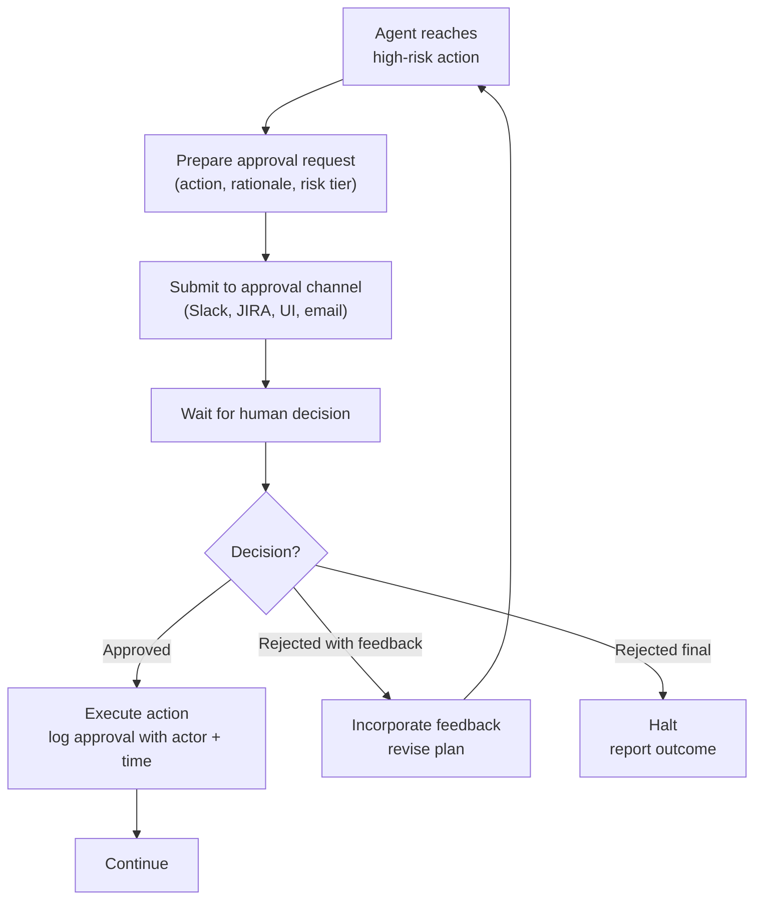
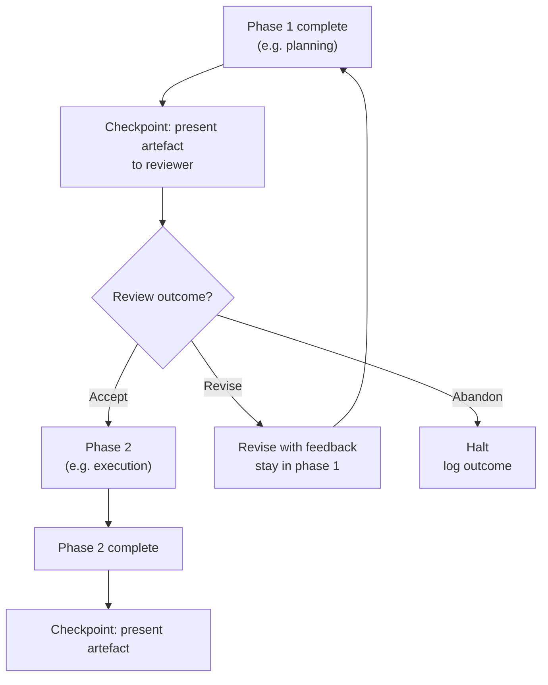

# Agentic Design Patterns Part 7: Human-in-the-Loop

Autonomous agents make mistakes. On low-stakes, reversible tasks that is acceptable — the cost of a wrong action is low and the agent can self-correct. On high-stakes, irreversible, or audit-sensitive tasks, mistakes are not acceptable and self-correction is not sufficient.

Human-in-the-loop (HITL) patterns define the control surfaces through which humans review, approve, redirect, and audit agent behaviour.

---

## Why Pure Automation Fails on High-Stakes Tasks

An autonomous agent that never pauses for human input has no mechanism to catch:

- Actions that are technically correct but wrong for the business context
- Scenarios where the agent's confidence is high but its information is stale
- Irreversible side effects (production changes, financial transactions, customer communications)
- Cases where policy requires human accountability, not just system automation

HITL patterns are not a sign of weak AI. They are a deliberate engineering choice to place accountability where it belongs.

---

## Risk-Based Gating

Not every action needs human review. Classify actions by impact and reversibility before deciding which patterns to apply.

| Risk tier | Description | HITL requirement |
|---|---|---|
| **Low** | Reversible, no external effect (e.g. draft a document) | None — escalation fallback only |
| **Medium** | Reversible external effect, bounded blast radius (e.g. open a PR, post a Slack message) | Optional checkpoint |
| **High** | Irreversible or broad impact (e.g. merge to main, deploy to prod, send email blast) | Mandatory approval gate |
| **Critical** | Compliance-required, financial, or regulatory (e.g. change RBAC policy, process payment) | Mandatory approval gate + audit log |

Assign a risk tier to every tool the agent can call. The tier determines which HITL pattern applies.

---

## Pattern 1: Approval Gate

The agent halts before a high-risk action and waits for explicit human approval. The agent does not proceed until it receives a signal.

### Structure



### What the approval request must include

The agent must give the reviewer enough context to make a real decision — not just "approve/reject" on an opaque action.

A good approval request contains:
- **What** the agent wants to do (the exact action and parameters)
- **Why** — the reasoning chain that led to this action
- **What happens if approved** — expected outcome and side effects
- **What happens if rejected** — alternative paths
- **Risk tier** — so the reviewer understands the stakes
- **Deadline** — if the decision must be made within a time window

```go
type ApprovalRequest struct {
    ID          string
    AgentID     string
    Action      ToolCall
    Rationale   string // the reasoning that led here
    Outcome     string // expected result if approved
    Alternatives []string // other paths if rejected
    RiskTier    RiskTier
    ExpiresAt   time.Time
}

type ApprovalGate struct {
    channel ApprovalChannel // Slack, Jira, webhook, database
    timeout time.Duration
}

func (g *ApprovalGate) RequestApproval(ctx context.Context, req ApprovalRequest) (ApprovalDecision, error) {
    if err := g.channel.Submit(ctx, req); err != nil {
        return ApprovalDecision{}, fmt.Errorf("submitting approval: %w", err)
    }

    ctx, cancel := context.WithTimeout(ctx, g.timeout)
    defer cancel()

    decision, err := g.channel.Wait(ctx, req.ID)
    if err != nil {
        if errors.Is(err, context.DeadlineExceeded) {
            return ApprovalDecision{}, ErrApprovalTimeout
        }
        return ApprovalDecision{}, err
    }

    return decision, nil
}
```

### Approval timeout handling

When a decision does not arrive within the timeout:

- **Safe default:** halt the agent and report the timeout. Do not proceed.
- **Escalation:** notify a secondary approver.
- **Auto-approve:** only for low-risk actions where the timer expiry itself is a business signal (use sparingly and document explicitly).

---

## Pattern 2: Checkpoint Review

The agent pauses at natural phase boundaries and presents a summary for review before moving to the next phase. This is less granular than approval gating on individual actions — it reviews a phase outcome, not a single step.

Checkpoint review is appropriate when:
- Each phase produces a reviewable artefact (a plan, a report, a draft)
- The reviewer needs to see the whole picture, not individual tool calls
- The cost of the next phase is high and should not be incurred on a flawed foundation

### Structure



### Implementation pattern

Checkpoint review differs from approval gating in that the agent actively summarises its work. The reviewer is not reading raw tool logs — they are reading a purpose-built summary.

```go
type Checkpoint struct {
    Phase     string
    Artefact  string // human-readable summary of phase output
    Evidence  []SourceRef // traceable links back to data sources
    NextPhase string
    RiskTier  RiskTier
}

type CheckpointReviewer interface {
    Present(ctx context.Context, cp Checkpoint) (ReviewDecision, error)
}

type ReviewDecision struct {
    Outcome   ReviewOutcome // Accept, Revise, Abandon
    Feedback  string
}
```

---

## Pattern 3: Escalation

The agent detects that it cannot proceed — due to uncertainty, conflict, missing information, or hitting a capability boundary — and hands off to a human with enough context to resolve the blocker and resume.

Escalation is an agent capability, not a failure mode. An agent that never escalates is either operating in a trivially simple domain or hiding failures.

### Escalation triggers

Define escalation conditions explicitly. Vague triggers ("escalate when unsure") produce escalations that humans cannot act on.

| Trigger | Description |
|---|---|
| **Confidence below threshold** | Agent's self-assessed confidence on a critical decision drops below a minimum |
| **Conflicting sources** | Two authoritative sources disagree and the agent cannot resolve the conflict by precedence rules |
| **Tool unavailability** | A required tool is unavailable and no alternative exists |
| **Missing required information** | The task requires information the agent does not have and cannot retrieve |
| **Policy hit** | The agent detects it would violate a policy if it proceeded |
| **Repeated failure** | The same step has failed N times and the agent cannot find an alternative |

```go
type EscalationTrigger struct {
    Reason      EscalationReason
    Context     string // what the agent was trying to do
    Blocker     string // what stopped it
    Suggestion  string // agent's best guess at resolution, if any
    PartialWork []CompletedStep // what was completed before escalation
}

type EscalationChannel interface {
    Escalate(ctx context.Context, trigger EscalationTrigger) error
    Resume(ctx context.Context, escalationID string) (ResumeSignal, error)
}
```

### Resumption

After a human resolves the blocker, the agent must be able to resume from where it left off. This requires:

1. Persisting agent state at the point of escalation (not just the escalation trigger)
2. A resumption mechanism that injects the human's resolution into the agent's context
3. A clear entry point to re-enter the loop

```go
type AgentState struct {
    TaskID      string
    History     []Message
    CompletedSteps []CompletedStep
    PendingStep    PlanStep
    Memory      MemorySnapshot
}

func (a *Agent) Suspend(ctx context.Context, state AgentState, trigger EscalationTrigger) (string, error) {
    suspendID := newID()
    if err := a.stateStore.Save(ctx, suspendID, state); err != nil {
        return "", fmt.Errorf("saving agent state: %w", err)
    }
    trigger.Context = fmt.Sprintf("[suspendID: %s] %s", suspendID, trigger.Context)
    return suspendID, a.escalationChannel.Escalate(ctx, trigger)
}

func (a *Agent) Resume(ctx context.Context, suspendID string, resolution string) error {
    state, err := a.stateStore.Load(ctx, suspendID)
    if err != nil {
        return fmt.Errorf("loading agent state: %w", err)
    }
    // Inject the human's resolution and re-enter the loop.
    state.History = append(state.History, Message{
        Role:    "system",
        Content: "Human resolution: " + resolution,
    })
    return a.continueFrom(ctx, state)
}
```

---

## Audit Trails

Every HITL interaction must produce an immutable audit record. This is not optional for production agents — it is the evidence that a human was in the loop when required.

### What to record

```go
type AuditEvent struct {
    Timestamp   time.Time
    AgentID     string
    TaskID      string
    EventType   AuditEventType // ApprovalRequested, ApprovalGranted, Escalated, Resumed, ...
    Actor       string         // agent identifier or human identity
    Action      *ToolCall      // the action under review (if applicable)
    Decision    *string        // the human's decision (if applicable)
    Rationale   string         // why this event occurred
    RiskTier    RiskTier
    TraceID     string         // correlation to distributed trace
}
```

### Storage requirements

- Append-only (no updates or deletes)
- Queryable by task, agent, actor, date range, and event type
- Retention aligned with compliance requirements (typically 1–7 years)
- Accessible to auditors independently of the agent runtime

---

## Composing HITL with Other Patterns

HITL is not a standalone pattern — it wraps other patterns at risk boundaries.

| Base pattern | HITL addition |
|---|---|
| ReAct | Approval gate before any tool with `riskTier >= High` |
| Plan-Execute | Checkpoint review after planning phase, before execution |
| Orchestrator/Worker | Escalation when a worker result conflicts with another |
| Reflection | Checkpoint review when critic flags a blocking quality failure after max rounds |
| Pipeline | Approval gate at stage boundaries that produce irreversible side effects |

A practical default: **Plan-Execute with checkpoint review after planning and approval gates before high-risk tools**. This covers the majority of production use cases without over-engineering.

---

## Anti-Patterns

**Rubber-stamp gates:** If the approval UI does not show rationale and evidence, reviewers will approve everything. The gate exists on paper but not in practice.

**Silent failure:** The agent fails silently rather than escalating. When it eventually produces output, no one knows which steps were skipped.

**Escalation without state:** The agent escalates but discards its state. The human must restart the task from scratch.

**Over-gating:** Every action requires approval. The agent is slower than a human doing the work manually and reviewers stop reading requests carefully.

**Under-gating:** No gates on actions the agent classifies as medium risk even when the aggregate effect of many medium-risk actions is high risk.

## What Comes Next

- [Part 8: Maersk Lens](agentic-patterns-maersk-lens.md) — Applying patterns to Maersk systems and tooling
