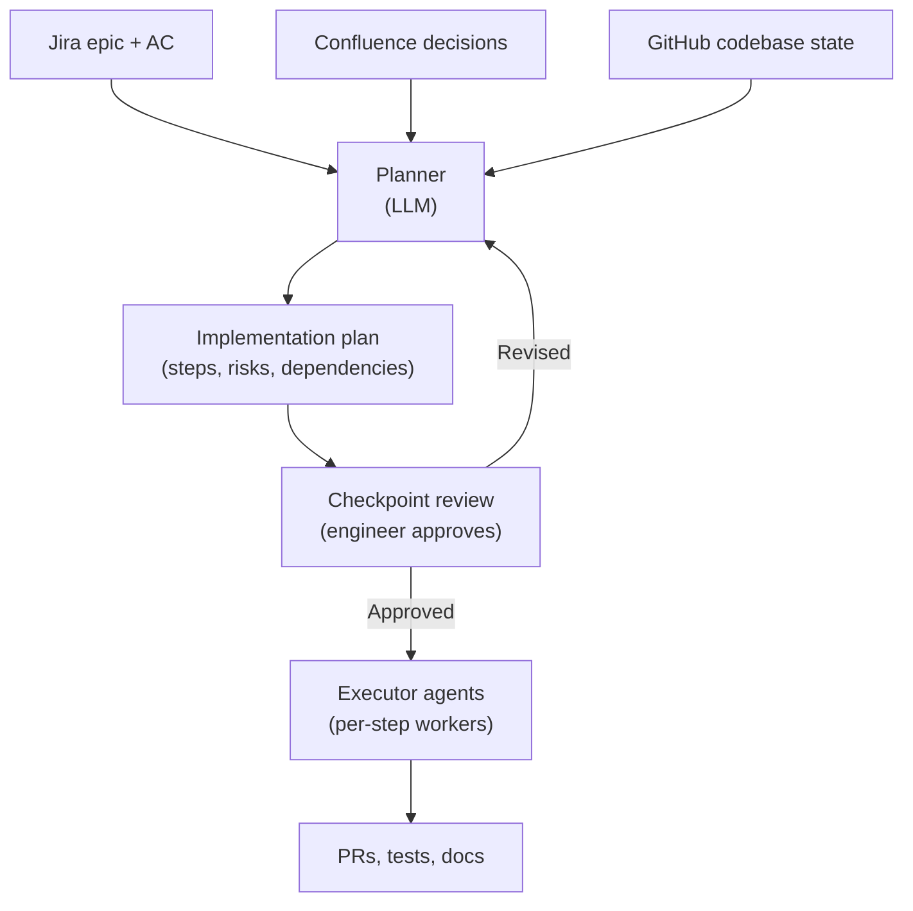
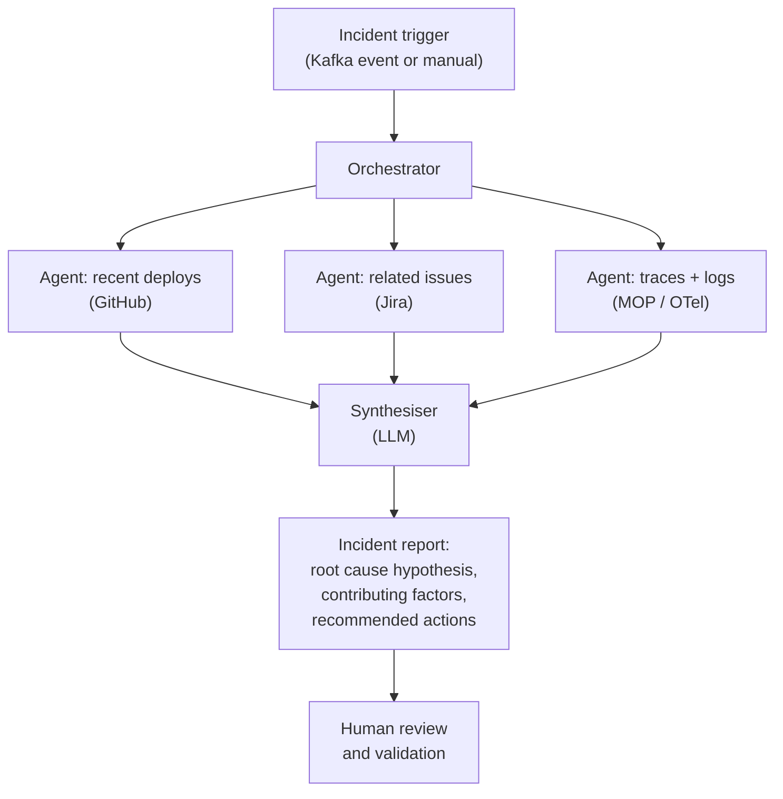

# Agentic Design Patterns Part 8: Maersk Lens

This guide applies the agentic design patterns series to how engineering teams work at Maersk. It maps patterns to Maersk tooling, identifies which patterns are appropriate for which problem types, and gives concrete starting recommendations.

---

## The Maersk Agentic Stack

Maersk engineering teams have a well-defined set of systems. Agents that work well here are grounded in these systems — not generic internet knowledge.

| System | Role in agentic workflows |
|---|---|
| **Jira** | Task authority — what we intend to do and current delivery state |
| **Confluence** | Decision authority — why we chose an approach, process runbooks |
| **GitHub** | Implementation authority — what the system actually does today |
| **Temporal** | Workflow engine — long-running, durable agentic workflows |
| **Kafka** | Event bus — trigger agents from system events; fan-out agent results |
| **OpenTelemetry / MOP** | Observability — trace agent calls end-to-end |
| **Azure Entra ID** | Identity — authenticate agents; scope tool access by role |

An agent that calls the wrong system as its source of truth for a domain will produce confidently wrong answers. The precedence rules from the [Context Engineering Maersk Lens](../context-engineering/context-engineering-maersk-lens.md) apply here too: GitHub for implementation truth, Jira for delivery truth, Confluence for decision rationale.

---

## Mapping Patterns to Maersk Use Cases

### Epic implementation planning

**Pattern:** Plan-Execute + Checkpoint Review

An agent reads the Jira epic (delivery intent), relevant Confluence pages (architecture decisions), and the current codebase (implementation truth). It produces a structured implementation plan. An engineer reviews the plan before any code is written.



**Why Plan-Execute:** The plan can be reviewed before expensive execution. Replanning is cheap; rewriting code is not.

**Why Checkpoint Review:** An engineer must own the implementation approach. The agent produces the plan; the engineer approves it.

---

### Production incident investigation

**Pattern:** ReAct + Parallel (for multi-system correlation)

An agent receives an incident trigger from Kafka (or a manual prompt). It investigates across GitHub (recent deploys), Jira (related tickets), and observability systems (traces, logs). It synthesises findings into a structured incident report.



**Why Parallel:** The three investigation threads are independent. Running them concurrently reduces investigation time.

**Why Human Review:** The incident report informs production changes. A human must validate before action is taken.

---

### Cross-repository code review

**Pattern:** Orchestrator/Worker

A change spans multiple repositories. An orchestrator identifies affected repos, dispatches a worker to each, and synthesises the findings into a unified review.

Each worker has access only to its repository's context — it does not need to know about the others. The orchestrator assembles the cross-cutting picture.

**Relevant Maersk context:** The Context Engineering SDK provides the context assembly for each worker. Each worker's context package includes: the PR diff, the relevant codebase state, the related Jira ticket, and any relevant Confluence architecture notes.

---

### Delivery status reporting

**Pattern:** Pipeline (Prompt Chaining)

A fixed sequence of agents transforms raw delivery data into a structured report.

| Stage | Input | Output |
|---|---|---|
| Fetch | Jira JQL query | Raw issue list |
| Classify | Raw issue list | Categorised by status, team, epic |
| Enrich | Categorised list | Add GitHub PR links, Confluence decision context |
| Assess | Enriched data | Risk flags, delivery confidence, blockers |
| Format | Assessment | Human-readable report in agreed template |

Each stage is narrow and independently testable. A failure at any stage halts the pipeline with a traceable error.

---

### Automated change management (high-risk)

**Pattern:** Plan-Execute + Approval Gate (Critical tier)

Any agent action that touches a production system, modifies RBAC policy, or triggers a financial process requires:

1. A plan reviewed and approved by an authorised human before any execution
2. An approval gate before each irreversible action
3. An immutable audit log with human actor identity, timestamp, and rationale

This is not optional. Maersk compliance requirements mandate human accountability for these action classes.

```go
// Risk tier classification for Maersk tool registry
var maerskToolRiskTiers = map[string]RiskTier{
    "jira_read":              RiskTierLow,
    "confluence_read":        RiskTierLow,
    "github_read":            RiskTierLow,
    "github_create_pr":       RiskTierMedium,
    "github_merge_pr":        RiskTierHigh,
    "github_push_to_main":    RiskTierCritical,
    "deploy_to_int":          RiskTierMedium,
    "deploy_to_prod":         RiskTierCritical,
    "jira_update_issue":      RiskTierLow,
    "jira_close_sprint":      RiskTierMedium,
    "send_team_notification": RiskTierMedium,
    "modify_rbac_policy":     RiskTierCritical,
}
```

---

## Temporal for Long-Running Agentic Workflows

Many Maersk agentic workflows span hours or days (epic implementation, cross-team delivery planning, incident post-mortems). These cannot run in a single LLM call. They need durable state, retries, and human checkpoints.

[Temporal](../skills/temporal-workflows/) is the right engine for this at Maersk.

### How it maps to agentic patterns

| Agentic pattern element | Temporal primitive |
|---|---|
| Agent state (suspend/resume) | Workflow execution (durable, survives process restarts) |
| Plan steps | Activities (each step is a retryable activity) |
| Parallel workers | Child workflows or activity fan-out |
| Human-in-the-loop checkpoint | `workflow.GetSignalChannel` — pause until signal arrives |
| Escalation with resumption | Workflow signals from external systems |
| Audit trail | Workflow event history (immutable, queryable) |

```go
// Skeleton: epic implementation agent as a Temporal workflow
func EpicImplementationWorkflow(ctx workflow.Context, req EpicRequest) error {
    // Phase 1: planning
    var plan ImplementationPlan
    if err := workflow.ExecuteActivity(ctx, BuildPlanActivity, req).Get(ctx, &plan); err != nil {
        return err
    }

    // Checkpoint: wait for engineer approval
    approvalCh := workflow.GetSignalChannel(ctx, "plan-approval")
    var decision ApprovalDecision
    approvalCh.Receive(ctx, &decision)
    if !decision.Approved {
        return workflow.NewApplicationError("plan rejected", "PlanRejected", decision.Feedback)
    }

    // Phase 2: execution — one activity per plan step
    for _, step := range plan.Steps {
        if step.RiskTier >= RiskTierHigh {
            // Pause for per-step approval on high-risk steps
            stepApprovalCh := workflow.GetSignalChannel(ctx, "step-approval-"+step.ID)
            var stepDecision ApprovalDecision
            stepApprovalCh.Receive(ctx, &stepDecision)
            if !stepDecision.Approved {
                // Halt the workflow rather than skipping and continuing.
                // Later steps may depend on this step's outputs; silently
                // skipping it would let them execute with missing prerequisites.
                // Halting surfaces the rejection explicitly and matches the
                // "Rejected final -> Halt" path from the HITL pattern.
                return workflow.NewApplicationError("step rejected", "StepRejected",
                    fmt.Sprintf("step %s rejected: %s", step.ID, stepDecision.Feedback))
            }
        }

        if err := workflow.ExecuteActivity(ctx, ExecuteStepActivity, step).Get(ctx, nil); err != nil {
            // Activity-level retry is handled by Temporal.
            // Escalate if it fails after all retries.
            var escalateErr error
            workflow.ExecuteActivity(ctx, EscalateActivity, EscalationTrigger{
                Reason:  EscalationReasonRepeatedFailure,
                Blocker: err.Error(),
            }).Get(ctx, &escalateErr)
            if escalateErr != nil {
                return fmt.Errorf("failed to escalate: %w", escalateErr)
            }

            // Suspend and wait for a human resolution signal before continuing.
            // Proceeding to the next step without human input would violate the
            // HITL suspend/resume pattern: later steps may depend on the failed
            // step's outputs, and silent continuation masks the failure.
            resumeCh := workflow.GetSignalChannel(ctx, "step-resume-"+step.ID)
            var resumeDecision ResumeDecision
            resumeCh.Receive(ctx, &resumeDecision)
            if !resumeDecision.Continue {
                return workflow.NewApplicationError("step halted after escalation", "StepHalted",
                    fmt.Sprintf("step %s halted: %s", step.ID, resumeDecision.Feedback))
            }
        }
    }

    return nil
}
```

---

## Kafka for Event-Driven Agent Triggers

Agents at Maersk are triggered by system events, not just manual prompts.

**Common trigger patterns:**

| Event | Triggering system | Agent response |
|---|---|---|
| PR opened | GitHub webhook → Kafka | Code review agent |
| Jira issue moved to "In Progress" | Jira webhook → Kafka | Context package assembly agent |
| Alert firing | MOP → Kafka | Incident investigation agent |
| Deployment completed | CD pipeline → Kafka | Post-deploy validation agent |
| Sprint closed | Jira → Kafka | Delivery summary report agent |

Use a Kafka consumer group per agent type. Each consumer deserialises the event, constructs the initial context package, and starts the relevant Temporal workflow.

```go
func (c *AgentConsumer) Handle(ctx context.Context, record *kgo.Record) error {
    var event SystemEvent
    if err := avro.Unmarshal(record.Value, &event); err != nil {
        return fmt.Errorf("deserialise: %w", err)
    }

    switch event.Type {
    case "github.pr.opened":
        return c.temporal.StartWorkflow(ctx, CodeReviewWorkflow, event.Payload)
    case "jira.issue.started":
        return c.temporal.StartWorkflow(ctx, ContextAssemblyWorkflow, event.Payload)
    case "alert.firing":
        return c.temporal.StartWorkflow(ctx, IncidentInvestigationWorkflow, event.Payload)
    default:
        slog.WarnContext(ctx, "unknown event type", "type", event.Type)
        return nil
    }
}
```

---

## Observability Requirements

All production agents at Maersk must be observable to the same standard as other services.

### Required telemetry

| Signal | What to capture |
|---|---|
| **Traces** | One span per agent step, tool call, and LLM invocation. Propagate trace context through Temporal activities and Kafka messages. |
| **Logs** | Structured log at each phase boundary with task ID, agent ID, step name, and outcome. |
| **Metrics** | Step latency, token usage per call, tool call success/failure rate, escalation rate, approval gate decision times. |
| **Audit events** | Immutable HITL record for all approval gates, checkpoints, and escalations. |

### LLM call instrumentation

```go
func (c *instrumentedLLMClient) Generate(ctx context.Context, req GenerateRequest) (GenerateResponse, error) {
    ctx, span := tracer.Start(ctx, "llm.generate",
        trace.WithAttributes(
            attribute.String("llm.model", req.Model),
            attribute.Int("llm.input_tokens_estimate", estimateTokens(req)),
        ),
    )
    defer span.End()

    start := time.Now()
    resp, err := c.inner.Generate(ctx, req)
    duration := time.Since(start)

    if err != nil {
        span.RecordError(err)
        llmCallErrors.Add(ctx, 1, metric.WithAttributes(attribute.String("model", req.Model)))
        return GenerateResponse{}, err
    }

    span.SetAttributes(
        attribute.Int("llm.input_tokens", resp.Usage.InputTokens),
        attribute.Int("llm.output_tokens", resp.Usage.OutputTokens),
    )
    llmCallDuration.Record(ctx, duration.Seconds(), metric.WithAttributes(attribute.String("model", req.Model)))
    llmTokensUsed.Add(ctx, int64(resp.Usage.InputTokens+resp.Usage.OutputTokens))

    return resp, nil
}
```

---

## Starting Recommendations for Maersk Teams

### Start with a pipeline

Pipelines are the lowest-risk starting point. They are deterministic, independently testable at each stage, and easy to observe. Build your first agent as a pipeline with narrow, focused stages before introducing dynamic reasoning.

### Add a ReAct agent for a single bounded domain

Pick one domain where tool-using agents deliver clear value (e.g. Jira query and summarisation). Build a ReAct agent with a small, well-defined tool set. Measure quality against human-produced output before expanding the tool set.

### Use Temporal from the start for anything that takes more than one minute

If the workflow spans multiple tool calls over time, use Temporal. The cost of retrofitting durable state into a stateless agent is high. Build it right the first time.

### Gate on risk, not on effort

Do not skip approval gates because implementing them takes extra work. Approval gates are the primary mechanism for maintaining human accountability in agentic systems. The effort is required.

### Treat escalation as a first-class feature

Build escalation into every agent that operates on medium-risk or higher tasks before you ship. An agent that cannot escalate is an agent that will silently fail or, worse, silently succeed at the wrong thing.

---

## Anti-Patterns at Maersk Scale

**Using Confluence as implementation truth.** Confluence documents drift. Always verify against GitHub before acting on implementation details from Confluence.

**Agents that send Slack or email without an approval gate.** External communications have real business impact. Treat `send_notification` as `RiskTierMedium` at minimum.

**Building custom state machines instead of using Temporal.** Custom retry and state management logic is a source of subtle, hard-to-diagnose bugs. Use Temporal for anything durable.

**Skipping OpenTelemetry trace propagation through Kafka.** When an agent workflow is triggered by a Kafka event, the trace must propagate through the message headers. Without this, you cannot correlate a production failure back to the agent action that caused it.

**Treating all LLM failures as hard failures.** Some LLM failures are transient (timeout, rate limit). Build retry with backoff for transient errors and escalation for persistent failures. Do not surface raw LLM errors to end users.
