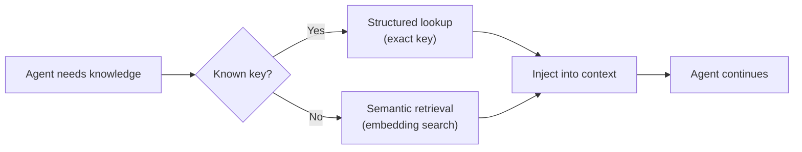
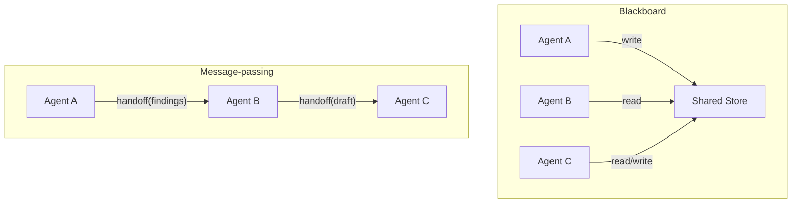
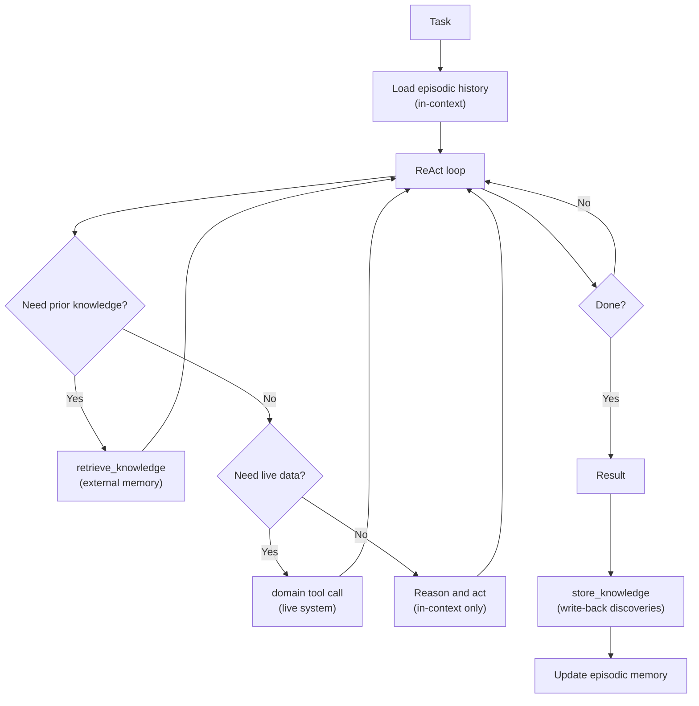

# Agentic Design Patterns Part 5: Memory

Agents that can only reason about what is in their current context window are severely limited. Memory extends agents across time: it lets them accumulate knowledge within a session, recall prior experience across sessions, and share state with other agents.

---

## Memory Type Overview

Memory is not a single thing. Agents have three distinct memory types, each with different characteristics and different management requirements.

| Type | Lifetime | Storage | Cost to access | Example |
|---|---|---|---|---|
| **In-context** | One interaction | Context window | Zero (already loaded) | Recent tool results, conversation history |
| **External** | Persistent | Vector store, database, key-value | One retrieval call | Codebase knowledge, past decisions, user preferences |
| **Episodic** | Session | Rolling buffer | Low (summarisation or truncation) | Prior turns in a long multi-turn conversation |

These compose. A long-running agent might load episodic history into context at session start, retrieve relevant external facts on demand, and accumulate tool results as in-context memory during execution.

---

## In-Context Memory

Everything currently in the context window is in-context memory. It is free to access but finite and temporary.

**Management rules:**

1. Treat in-context memory as a budget, not a dump (see [Context Engineering Part 4](../context-engineering/context-engineering-context-budget-advanced.md))
2. Prioritise recent tool results over older ones when trimming
3. Summarise completed reasoning chains rather than retaining the full trace
4. Do not repeat the same information under multiple headings — deduplication saves tokens

**In-context memory decay:**

As an agent accumulates tool results over many steps, the context fills. The oldest, least-relevant material should be compressed or dropped first. Never silently drop constraints, criteria, or the original task definition — these must persist for the full interaction.

```go
type ContextManager struct {
    budget    int
    messages  []Message
    protected []string // content that must never be trimmed
}

func (m *ContextManager) Add(msg Message) {
    m.messages = append(m.messages, msg)
    for m.tokenCount() > m.budget {
        if !m.evictOldest() {
            break // all remaining messages are protected; cannot free further tokens
        }
    }
}

// evictOldest removes the oldest unprotected message and returns true.
// Returns false if all messages are protected and nothing could be evicted.
func (m *ContextManager) evictOldest() bool {
    for i, msg := range m.messages {
        if !m.isProtected(msg) {
            m.messages = slices.Delete(m.messages, i, i+1)
            return true
        }
    }
    return false
}
```

**Priority-weighted eviction:**

Not all messages are equally valuable. Assign priority scores so that high-value observations (rare data, decisions made, errors encountered) survive longer than low-value filler (intermediate reasoning steps, redundant confirmations).

```go
type ScoredMessage struct {
    Message  Message
    Priority int    // higher = more likely to survive eviction
    TokenLen int
}

func (m *ContextManager) evictLowestPriority() {
    lowest := 0

    if len(m.scored) == 0 {
        return
    
    }

    for i := 1; i < len(m.scored); i++ {
        if m.scored[i].Priority < m.scored[lowest].Priority {
            lowest = i
        }
    }
    m.scored = slices.Delete(m.scored, lowest, lowest+1)
}
```

---

## External Memory

External memory stores knowledge outside the context window and retrieves it on demand. The two primary forms are:

**Semantic retrieval (vector store):**
Store chunks of knowledge as embeddings. At query time, retrieve the top-k most semantically relevant chunks. Best for unstructured knowledge: documents, code, meeting transcripts.

**Structured retrieval (database / key-value):**
Store structured facts keyed by ID or query. At query time, look up exact facts. Best for precise, structured data: configuration, prior decisions, user records.



**Retrieval as a tool:**

Treat external memory retrieval as a tool call. This makes memory access explicit, observable, and controllable. The agent reasons about what it needs and requests it — rather than having a retrieval layer guess.

```go
type MemoryTool struct {
    vectorStore  VectorStore
    structuredDB StructuredDB
}

func (m *MemoryTool) Definition() ToolDefinition {
    return ToolDefinition{
        Name:        "retrieve_knowledge",
        Description: "Retrieve relevant knowledge from the knowledge base. Use when you need information that is not in your current context.",
        Parameters: map[string]ParameterDef{
            "query":  {Type: "string", Description: "What you want to know"},
            "kind":   {Type: "string", Enum: []string{"semantic", "exact"}, Description: "semantic for open-ended queries, exact for known IDs"},
            "key":    {Type: "string", Description: "Required for kind=exact: the exact key to look up"},
            "limit":  {Type: "integer", Description: "Maximum number of results to return (default 5)"},
        },
    }
}

func (m *MemoryTool) Execute(ctx context.Context, params map[string]any) (string, error) {
    kind, _ := params["kind"].(string)

    switch kind {
    case "exact":
        key, ok := params["key"].(string)
        if !ok || key == "" {
            return "", fmt.Errorf("kind=exact requires a non-empty 'key' parameter")
        }
        return m.structuredDB.Get(ctx, key)
    default:
        query, _ := params["query"].(string)
        // JSON unmarshalling into map[string]any produces float64 for numbers,
        // not int — so assert to float64 first.
        var limit int
        if f, ok := params["limit"].(float64); ok {
            limit = int(f)
        }
        if limit == 0 {
            limit = 5
        }
        chunks, err := m.vectorStore.Search(ctx, query, limit)
        if err != nil {
            return "", err
        }
        return formatChunks(chunks), nil
    }
}
```

### Memory write-back

Read-only retrieval is not enough for agents that discover or generate knowledge during execution. An agent that investigates an incident, finds the root cause, and writes it back creates a persistent record that future agents (or future runs of the same agent) can build on.

Write-back requires discipline: write only facts, decisions, and conclusions — not raw reasoning traces. Raw traces are verbose, stale quickly, and pollute retrieval results.

```go
func (m *MemoryTool) WriteDefinition() ToolDefinition {
    return ToolDefinition{
        Name:        "store_knowledge",
        Description: "Persist a fact, decision, or conclusion to the knowledge base for future use. Only call this for information that will be useful in future sessions or to other agents. Do not write intermediate reasoning.",
        Parameters: map[string]ParameterDef{
            "key":     {Type: "string", Description: "A stable, descriptive key (e.g. 'incident/PAY-2024-11-incident-root-cause')"},
            "content": {Type: "string", Description: "The fact or conclusion to store"},
            "kind":    {Type: "string", Enum: []string{"fact", "decision", "reference"}, Description: "Type of knowledge"},
        },
    }
}
```

### Memory invalidation

External memory goes stale. A fact that was true six months ago may be dangerously wrong today. Two strategies:

| Strategy | Mechanism | Best for |
|---|---|---|
| **TTL** | Every record has an expiry timestamp; expired records are excluded from retrieval | Volatile facts (deployment versions, on-call rosters) |
| **Explicit invalidation** | An agent or process marks records as superseded when the underlying truth changes | Decisions and policies that change deliberately |

Always include a `stored_at` timestamp in memory records. Agents should be aware of age when using retrieved facts, especially for operational data.

---

## Episodic Memory

Episodic memory is a rolling record of recent session history. It gives long-running conversational agents a sense of continuity across turns without injecting the entire conversation into every call.

**Management approaches:**

| Approach | Mechanism | Trade-off |
|---|---|---|
| **Fixed window** | Keep the last N turns verbatim | Simple; may lose important context |
| **Summary** | Periodically summarise older turns | Preserves meaning; adds latency |
| **Selective** | Keep turns that were flagged as important | High fidelity; requires explicit flagging |
| **Hybrid** | Full recent turns + summary of older turns | Best quality; most complex |

```go
type EpisodicMemory struct {
    recentTurns    []Turn       // verbatim, kept as-is
    historySummary string       // compressed summary of older turns
    summariser     LLMClient
    windowSize     int          // max turns to keep verbatim
}

func (e *EpisodicMemory) AddTurn(ctx context.Context, t Turn) error {
    e.recentTurns = append(e.recentTurns, t)

    if len(e.recentTurns) > e.windowSize {
        // Compress the oldest turn into the running summary.
        oldest := e.recentTurns[0]
        e.recentTurns = e.recentTurns[1:]

        var err error
        e.historySummary, err = e.summariser.UpdateSummary(ctx, e.historySummary, oldest)
        if err != nil {
            return fmt.Errorf("episodic compression: %w", err)
        }
    }

    return nil
}

func (e *EpisodicMemory) ToMessages() []Message {
    msgs := []Message{}
    if e.historySummary != "" {
        msgs = append(msgs, Message{
            Role:    "system",
            Content: "Prior conversation summary:\n" + e.historySummary,
        })
    }
    for _, t := range e.recentTurns {
        msgs = append(msgs, t.ToMessages()...)
    }
    return msgs
}
```

---

## Shared Memory in Multi-Agent Systems

Single-agent memory is private by default. In multi-agent systems, agents often need to share state: a researcher agent's findings should be visible to the writer agent; a monitor agent's alerts should be visible to the responder.

Two sharing models:

**Blackboard model:** All agents read from and write to a shared store. No agent owns the state. Simple to implement; can cause contention.

**Message-passing model:** Agents pass memory payloads explicitly in their handoff messages. The receiving agent decides what to load into its own context. Higher control; more boilerplate.



**Namespace isolation:** When multiple agents write to the same store, use namespaced keys to prevent collisions and to make attribution clear.

```go
type AgentMemory struct {
    store     KVStore
    agentID   string
    namespace string
}

func (m *AgentMemory) Write(ctx context.Context, key, value string) error {
    fullKey := fmt.Sprintf("%s/%s/%s", m.namespace, m.agentID, key)
    return m.store.Set(ctx, fullKey, value)
}

func (m *AgentMemory) ReadFrom(ctx context.Context, otherAgentID, key string) (string, error) {
    fullKey := fmt.Sprintf("%s/%s/%s", m.namespace, otherAgentID, key)
    return m.store.Get(ctx, fullKey)
}
```

---

## Putting It Together

A mature agent uses all three memory types in combination:



The key principle: memory and tool results are both observations. Whether the agent calls `retrieve_knowledge` or `get_deployment_status`, the result is the same — new information enters the context and the agent reasons about it.

---

## What Comes Next

- [Part 6: Tool Use](agentic-patterns-tool-use.md) — Tool design, error handling, registries, parallel calling, and MCP
- [Part 7: Human-in-the-Loop](agentic-patterns-human-in-the-loop.md) — Approval gates, checkpoints, escalation
- [Part 8: Maersk Lens](agentic-patterns-maersk-lens.md) — Applying patterns to Maersk systems and tooling
