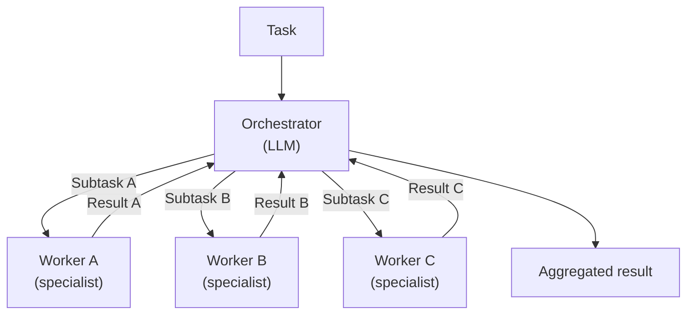
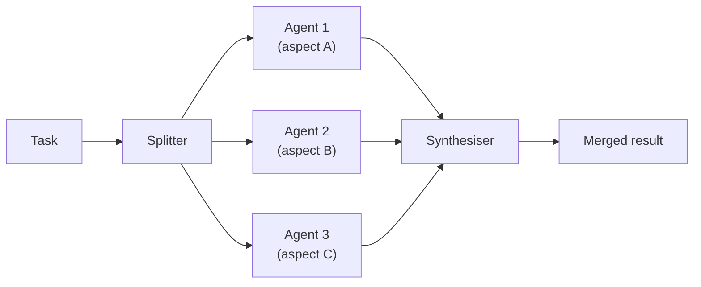
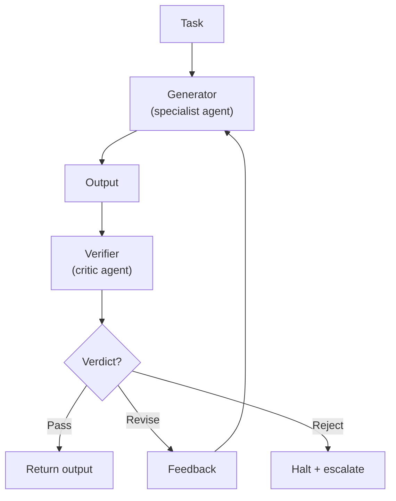

# Agentic Design Patterns Part 4: Multi-Agent Patterns

When a single agent is not enough — because the task is too broad, requires specialist knowledge, or benefits from parallel execution — multi-agent patterns distribute the work across a coordinated system.

This article covers three multi-agent patterns: Orchestrator/Worker, Parallel (Fan-out/Fan-in), and Critic/Verifier.

---

## Why Multiple Agents?

A single agent faces hard limits:

- **Context window:** A complex task requires more information than any single call can hold
- **Specialisation:** Different subtasks need different tools, models, or instructions
- **Parallelism:** Independent subtasks that run sequentially add latency without benefit
- **Failure isolation:** A failure in one part should not invalidate completed work

Multi-agent patterns solve these problems by decomposing work, assigning it to focused agents, and coordinating the results.

The cost is coordination overhead: more LLM calls, more failure surfaces, harder debugging. Adopt multi-agent only when a single agent demonstrably cannot do the job.

---

## Orchestrator / Worker

The orchestrator decomposes the task, assigns work to worker agents, and aggregates their results. Workers have a narrow scope and do not need to know about the broader task.

The orchestrator does not execute steps directly. It plans, delegates, monitors, and synthesises.

### Structure



### When to use Orchestrator/Worker

- The task decomposes into well-defined, independent subtasks
- Each subtask benefits from a focused context (a worker sees only what it needs)
- Subtask results need synthesis or conflict resolution before the final answer
- Examples: multi-repo code review, incident root cause analysis, cross-team delivery planning

### Orchestrator responsibilities

1. Decompose the task into subtasks with clear, testable acceptance criteria
2. Select the right worker for each subtask (or parameterise a generic worker)
3. Detect when a worker result is incomplete or erroneous
4. Synthesise results, resolve conflicts, and produce a coherent output
5. Escalate if the task cannot be completed with available workers

### Go Implementation

```go
type Subtask struct {
    ID           string
    Description  string
    WorkerType   string
    Input        map[string]any
}

type WorkerResult struct {
    SubtaskID string
    Output    string
    Quality   float64 // 0–1 confidence score from the worker
    Err       error
}

type OrchestratorAgent struct {
    planner    LLMClient // decomposes task into subtasks
    workers    WorkerRegistry
    synthesiser LLMClient // merges worker results
}

func (a *OrchestratorAgent) Run(ctx context.Context, task string) (string, error) {
    subtasks, err := a.planner.Decompose(ctx, task)
    if err != nil {
        return "", fmt.Errorf("decomposition: %w", err)
    }

    results := a.runWorkers(ctx, subtasks)

    successful := filterSuccessful(results)
    if len(successful) == 0 {
        return "", errors.New("all workers failed")
    }

    return a.synthesiser.Synthesise(ctx, task, successful)
}

func (a *OrchestratorAgent) runWorkers(ctx context.Context, subtasks []Subtask) []WorkerResult {
    results := make([]WorkerResult, len(subtasks))
    var wg sync.WaitGroup

    for i, st := range subtasks {
        i, st := i, st
        wg.Add(1)
        go func() {
            defer wg.Done()
            worker, err := a.workers.Get(st.WorkerType)
            if err != nil {
                results[i] = WorkerResult{SubtaskID: st.ID, Err: fmt.Errorf("worker %s: %w", st.WorkerType, err)}
                return
            }
            result, err := worker.Execute(ctx, st)
            result.SubtaskID = st.ID
            result.Err = err
            results[i] = result
        }()
    }

    wg.Wait()
    return results
}
```

---

## Parallel (Fan-out / Fan-in)

Multiple independent agents run concurrently on different aspects of the same task. A synthesiser merges the results. Unlike Orchestrator/Worker, there is no ongoing coordination — agents run to completion independently.

### Structure



### When to use Parallel

- Subtasks have no data dependencies on each other
- The same question benefits from multiple independent perspectives (e.g. security review + performance review + correctness review of the same PR)
- Latency is critical and steps can be parallelised
- Results need to be merged, not just concatenated

### Difference from Orchestrator/Worker

| | Orchestrator/Worker | Parallel |
|---|---|---|
| Coordination | Ongoing (orchestrator monitors) | None (fire and gather) |
| Subtask discovery | Dynamic (orchestrator decides at runtime) | Static (splitter decides upfront) |
| Error handling | Orchestrator can replan | Synthesiser handles missing results |
| Complexity | Higher | Lower |

### Go Implementation

```go
type ParallelAgent struct {
    agents      []SpecialistAgent
    synthesiser LLMClient
}

type SpecialistAgent interface {
    Name() string
    Run(ctx context.Context, input string) (string, error)
}

type ParallelResult struct {
    AgentName string
    Output    string
    Err       error
}

func (a *ParallelAgent) Run(ctx context.Context, input string) (string, error) {
    results := make([]ParallelResult, len(a.agents))
    var wg sync.WaitGroup

    for i, agent := range a.agents {
        i, agent := i, agent
        wg.Add(1)
        go func() {
            defer wg.Done()
            output, err := agent.Run(ctx, input)
            results[i] = ParallelResult{AgentName: agent.Name(), Output: output, Err: err}
        }()
    }

    wg.Wait()

    // Synthesise, including any partial results if some agents failed.
    successful := filterSuccessful(results)
    if len(successful) == 0 {
        return "", errors.New("all parallel agents failed")
    }

    return a.synthesiser.Merge(ctx, input, successful)
}
```

---

## Critic / Verifier

A generator agent produces output. A separate verifier agent evaluates it against explicit criteria and returns a verdict: pass, revise, or reject. If the verdict is revise, the generator incorporates the feedback and tries again. The two agents are independent — they have separate contexts, can use different models, and can be developed and tested in isolation.

This is distinct from the Reflection pattern in core loops. Reflection is self-critique within a single agent's context. Critic/Verifier is a second agent with its own system prompt, its own specialisation, and optionally its own tools.

### Structure



### When to use Critic/Verifier

- The generator and the reviewer require different expertise or tools (e.g. a code generator and a security reviewer)
- The quality criteria are explicit and can be encoded as a verifier system prompt
- You want the reviewer to be independently testable — including against known-bad outputs
- Self-critique (Reflection) has proven insufficient because the generator's blind spots are consistent
- Examples: code generation + policy compliance check, incident report + factual accuracy check against telemetry, architecture proposal + constraint validation

### Verdicts

The verifier returns one of three outcomes:

| Verdict | Meaning | Generator action |
|---|---|---|
| **Pass** | Output meets criteria | Return to caller |
| **Revise** | Output has fixable issues; feedback provided | Incorporate feedback and regenerate |
| **Reject** | Output cannot be salvaged | Halt; escalate to human or fail loudly |

A verifier that only returns pass/fail is half-built. Actionable feedback is what makes the revision loop useful.

### Go Implementation

```go
type Verdict struct {
    Status   VerdictStatus // Pass, Revise, Reject
    Feedback string        // empty on Pass; required on Revise; reason on Reject
    Score    float64       // 0–1, useful for logging and dashboards
}

type VerdictStatus int

const (
    VerdictPass   VerdictStatus = iota
    VerdictRevise               // fixable; feedback provided
    VerdictReject               // not fixable
)

type GeneratorAgent interface {
    Generate(ctx context.Context, task string) (string, error)
    Revise(ctx context.Context, task, previous, feedback string) (string, error)
}

type VerifierAgent interface {
    Verify(ctx context.Context, task, output string) (Verdict, error)
}

type CriticVerifierSystem struct {
    generator  GeneratorAgent
    verifier   VerifierAgent
    maxRetries int
}

func (s *CriticVerifierSystem) Run(ctx context.Context, task string) (string, error) {
    output, err := s.generator.Generate(ctx, task)
    if err != nil {
        return "", fmt.Errorf("generator: %w", err)
    }

    for attempt := range s.maxRetries {
        verdict, err := s.verifier.Verify(ctx, task, output)
        if err != nil {
            return "", fmt.Errorf("verifier attempt %d: %w", attempt, err)
        }

        switch verdict.Status {
        case VerdictPass:
            return output, nil
        case VerdictReject:
            return "", fmt.Errorf("output rejected: %s", verdict.Feedback)
        case VerdictRevise:
            output, err = s.generator.Revise(ctx, task, output, verdict.Feedback)
            if err != nil {
                return "", fmt.Errorf("revision attempt %d: %w", attempt, err)
            }
        }
    }

    return "", fmt.Errorf("output did not pass verification after %d attempts", s.maxRetries)
}
```

---

## Choosing Between the Patterns

| Question | Recommendation |
|---|---|
| Do subtasks depend on each other's results? | Orchestrator/Worker (dynamic coordination) |
| Are subtasks truly independent and running in parallel? | Parallel fan-out |
| Is the processing sequence fixed and steps are simple LLM calls? | [Prompt Chaining](agentic-patterns-prompt-chaining.md) |
| Do I need dynamic replanning if a step fails? | Orchestrator/Worker |
| Do I want multiple perspectives on the same input? | Parallel fan-out |
| Does the generator have consistent blind spots that need external review? | Critic/Verifier |
| Are the generator and reviewer genuinely different specialisations? | Critic/Verifier |

---

## Observability

Multi-agent systems are harder to debug than single agents. Make every boundary observable:

- Log each subtask assignment and result at the orchestrator
- Include agent name, input hash, output hash, and latency in every span
- Propagate trace context (e.g. OpenTelemetry) from the root task through every agent call
- Emit a structured event when an agent fails, retries, or escalates

Without this, a failure deep in a worker is invisible at the surface.

```go
func (a *OrchestratorAgent) runWithTrace(ctx context.Context, st Subtask) (WorkerResult, error) {
    ctx, span := tracer.Start(ctx, "agent.worker",
        trace.WithAttributes(
            attribute.String("subtask.id", st.ID),
            attribute.String("worker.type", st.WorkerType),
        ),
    )
    defer span.End()

    result, err := a.workers.Get(st.WorkerType).Execute(ctx, st)
    if err != nil {
        span.RecordError(err)
        span.SetStatus(codes.Error, err.Error())
    }

    return result, err
}
```

## What Comes Next

- [Part 5: Memory](agentic-patterns-memory.md) — In-context, external, and episodic memory; write-back; shared memory
- [Part 6: Tool Use](agentic-patterns-tool-use.md) — Tool design, error handling, parallel calling, caching, and MCP
- [Part 7: Human-in-the-Loop](agentic-patterns-human-in-the-loop.md) — Approval gates, checkpoints, escalation
- [Part 8: Maersk Lens](agentic-patterns-maersk-lens.md) — Applying patterns to Maersk systems and tooling
