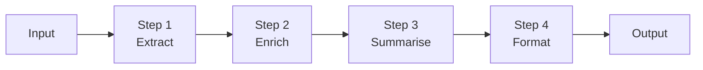
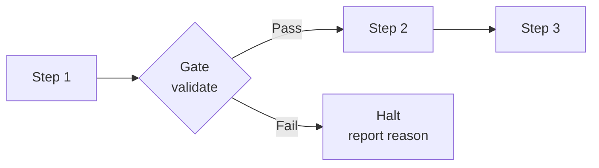
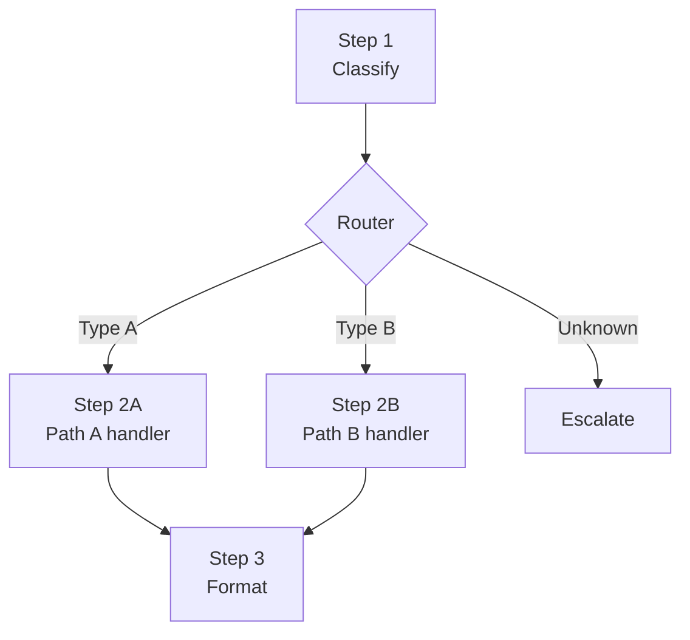

# Agentic Design Patterns Part 3: Prompt Chaining

Prompt chaining is the practice of decomposing a complex task into a sequence of focused LLM calls, where the output of each step becomes the input to the next. Each step has a single, narrow responsibility. The structure is fixed at design time.

This article covers the linear chain, gate and routing patterns, and the tradeoffs that should guide when to reach for chaining over a full agentic loop.

---

## Why Prompt Chaining?

A single prompt that asks an LLM to extract, validate, enrich, and format a document in one pass will produce worse results than four focused prompts doing one thing each. There are three reasons:

1. **Attention dilution.** A monolithic prompt splits the model's attention across competing concerns. A focused prompt concentrates it on one.
2. **Composability.** Each step is independently testable and replaceable. You can swap a summarisation step for a better model without touching the rest of the chain.
3. **Observability.** Every intermediate result is inspectable. When something goes wrong, you know which step produced the bad output — not just that the final output is wrong.

Prompt chaining is not an agentic loop. The model does not decide what to do next. The structure of the chain is your decision, made at design time.

---

## The Linear Chain

The simplest form: output of step N flows directly into step N+1. No branching, no feedback, no loops.

### Structure



### Example: incident report enrichment

```
Input:       Raw alert payload from PagerDuty

Step 1 — Extract:
  Prompt:    "Extract the service name, error type, and first occurrence time from this alert."
  Output:    { "service": "payments", "error": "timeout", "since": "14:32 UTC" }

Step 2 — Enrich:
  Prompt:    "Given this incident, identify the on-call owner and the last deployment for the service."
  Tools:     get_oncall("payments"), list_deployments("payments", limit=1)
  Output:    { "owner": "alice@example.com", "last_deploy": "14:15 UTC by bob@example.com" }

Step 3 — Summarise:
  Prompt:    "Write a one-paragraph incident summary for a Slack post."
  Output:    "The payments service has been experiencing timeouts since 14:32 UTC..."

Step 4 — Format:
  Prompt:    "Format this summary as a Slack Block Kit message."
  Output:    { "blocks": [...] }
```

Each step sees only the output of the previous step plus a focused system prompt. No step needs to know about the full chain.

### When to use a linear chain

- The transformation sequence is known upfront and does not depend on intermediate results
- Each step has a clear input/output contract
- You want fully predictable, deterministic flow
- Output quality degrades when a single LLM handles all concerns at once

### When a linear chain is not enough

- The next step depends on the *meaning* of the previous result (use ReAct instead)
- Some steps should be skipped based on what is discovered (use routing, below)
- Steps need to share tool access across a reasoning loop (use a core loop pattern)

---

## Gates

A gate is a validation step between two chain stages. It evaluates whether the output of the previous step is fit to proceed. If not, the chain halts or routes to a fallback.

### Structure



### Gate types

| Gate type | What it checks | Example |
|---|---|---|
| **Schema gate** | Output conforms to the expected structure | Step 1 extracted required fields |
| **Quality gate** | Output meets a quality threshold | Summary is coherent and on-topic |
| **Policy gate** | Output does not violate a rule | No PII in the formatted message |
| **Completeness gate** | Required information is present | All mandatory fields populated |

A gate does not need to be an LLM call. A schema gate is a JSON schema validation. A completeness gate is a field-presence check. Reserve LLM-based gates for quality or policy judgements that cannot be expressed as rules.

```go
type GateResult struct {
    Pass   bool
    Reason string // non-empty on failure, explains what was wrong
}

type Gate func(ctx context.Context, output string) GateResult

func SchemaGate(schema jsonschema.Schema) Gate {
    return func(_ context.Context, output string) GateResult {
        if err := schema.Validate(output); err != nil {
            return GateResult{Pass: false, Reason: err.Error()}
        }
        return GateResult{Pass: true}
    }
}

func LLMQualityGate(llm LLMClient, criteria string) Gate {
    return func(ctx context.Context, output string) GateResult {
        result, err := llm.Evaluate(ctx, output, criteria)
        if err != nil {
            return GateResult{Pass: false, Reason: err.Error() }
        }
        return GateResult{Pass: result.Score >= 0.8, Reason: result.Feedback}
    }
}
```

---

## Routing

A router reads the output of one step and selects which step to run next. Unlike a gate (pass/fail), a router chooses between two or more branches.

### Structure



### Example: change request triage

```
Step 1 — Classify:
  Prompt:    "Classify this change request as: routine, expedited, or emergency."
  Output:    { "type": "expedited", "rationale": "..." }

Router:
  "expedited" → Step 2A: expedited approval workflow
  "emergency" → Step 2B: emergency CAB notification
  "routine"   → Step 2C: standard 5-day review queue
```

Routers are usually simple conditional logic over a structured output. Avoid using an LLM to route if a rule will do.

```go
type Router func(output string) (nextStage string, err error)

func ClassificationRouter(output string) (string, error) {
    var result struct {
        Type string `json:"type"`
    }
    if err := json.Unmarshal([]byte(output), &result); err != nil {
        return "", fmt.Errorf("router: invalid output: %w", err)
    }
    switch result.Type {
    case "expedited":
        return "expedited-handler", nil
    case "emergency":
        return "emergency-handler", nil
    case "routine":
        return "routine-handler", nil
    default:
        return "escalate", nil
    }
}
```

---

## Go Implementation

A minimal, composable pipeline:

```go
// Stage transforms a document, returning the enriched document or an error.
type Stage func(ctx context.Context, doc Document) (Document, error)

// Document is the common envelope passed between stages.
// Extend with domain-specific fields as needed.
type Document struct {
    Input     string
    Extracted map[string]any
    Enriched  map[string]any
    Output    string
    Metadata  map[string]any
}

type Pipeline struct {
    stages []Stage
}

func NewPipeline(stages ...Stage) *Pipeline {
    return &Pipeline{stages: stages}
}

func (p *Pipeline) Run(ctx context.Context, input string) (Document, error) {
    doc := Document{Input: input}

    for i, stage := range p.stages {
        var err error
        doc, err = stage(ctx, doc)
        if err != nil {
            return doc, fmt.Errorf("stage %d: %w", i, err)
        }
    }

    return doc, nil
}
```

Wrapping an LLM call as a stage:

```go
func LLMStage(llm LLMClient, systemPrompt string, inject func(Document) string) Stage {
    return func(ctx context.Context, doc Document) (Document, error) {
        userMessage := inject(doc)
        response, err := llm.Complete(ctx, systemPrompt, userMessage)
        if err != nil {
            return doc, err
        }
        doc.Output = response
        return doc, nil
    }
}
```

Wrapping a gate as a stage:

```go
func GateStage(gate Gate) Stage {
    return func(ctx context.Context, doc Document) (Document, error) {
        result := gate(ctx, doc.Output)
        if !result.Pass {
            return doc, fmt.Errorf("gate failed: %s", result.Reason)
        }
        return doc, nil
    }
}
```

A full chain composition:

```go
pipeline := NewPipeline(
    LLMStage(llm, extractSystemPrompt, func(d Document) string { return d.Input }),
    GateStage(SchemaGate(extractedSchema)),
    LLMStage(llm, enrichSystemPrompt, func(d Document) string { return d.Output }),
    LLMStage(llm, summariseSystemPrompt, func(d Document) string { return d.Output }),
    GateStage(LLMQualityGate(llm, "Is the summary coherent and factually consistent with the input?")),
    LLMStage(llm, formatSystemPrompt, func(d Document) string { return d.Output }),
)
```

---

## Prompt Chaining vs. the Other Patterns

| | Prompt Chaining | ReAct | Multi-Agent Pipeline |
|---|---|---|---|
| **Structure** | Fixed at design time | Emergent (model decides next step) | Fixed at design time |
| **Each stage** | Single LLM call | Interleaved thought + tool calls | Full agent with its own loop |
| **Tool access** | Optional, per-stage | Central to the loop | Per-agent |
| **Dynamic replanning** | No | Yes | No |
| **Cost** | Low (minimal tokens per step) | Medium | High (multiple agent loops) |
| **Predictability** | High | Low | High |
| **Best for** | Known, sequential transformations | Open-ended exploration | Complex stages each requiring multi-step reasoning |

Choose prompt chaining when you know the steps upfront and each step is a focused transformation. Reach for ReAct when the path is not known in advance. Reach for a multi-agent pipeline when each stage is complex enough to need its own reasoning loop.

---

## Common Failure Modes

**Error amplification.** A bad output from step 1 propagates through every subsequent step. Use schema gates and quality gates at critical transitions — not only at the end.

**Context loss.** Each step sees only what you explicitly pass to it. If step 3 needs something produced by step 1 but not passed by step 2, you must thread it through the document envelope. Design your `Document` struct around what each step needs, not what is convenient to produce.

**Over-chaining.** More steps is not always better. Every additional LLM call adds latency and cost. If steps 2 and 3 are always called together and share context naturally, merge them.

**Silent degradation.** Without gates, a low-quality intermediate result will silently produce a plausible-looking final output. Add an LLM quality gate at any step where correctness matters for everything downstream.

## What Comes Next

- [Part 4: Multi-Agent Patterns](agentic-patterns-multi-agent.md) — Orchestrator/Worker, parallel, pipeline
- [Part 5: Memory](agentic-patterns-memory.md) — In-context, external, and episodic memory; write-back; shared memory
- [Part 6: Tool Use](agentic-patterns-tool-use.md) — Tool design, error handling, parallel calling, caching, and MCP
- [Part 7: Human-in-the-Loop](agentic-patterns-human-in-the-loop.md) — Approval gates, checkpoints, escalation
- [Part 8: Maersk Lens](agentic-patterns-maersk-lens.md) — Applying patterns to Maersk systems and tooling
