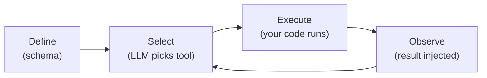
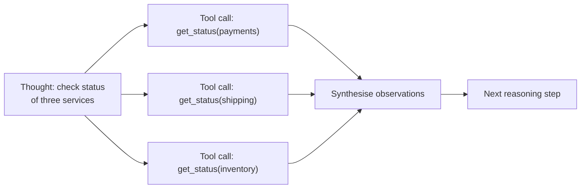
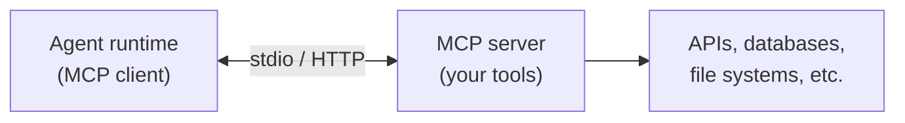

# Agentic Design Patterns Part 6: Tool Use

Tools ground agents in real-world state. Without tools, agents can only reason about what is in their context. With tools, they can read live data, execute code, call APIs, write to systems, and trigger workflows.

---

## Tool Lifecycle

Every tool interaction has four phases:



1. **Define** — a schema tells the model what the tool does, what it expects, and what it returns
2. **Select** — the model decides whether to call the tool, and with what parameters
3. **Execute** — your code runs; the model is not involved in this step
4. **Observe** — the result is injected into context as the next input to the reasoning step

Tool errors are part of the loop. A well-designed agent handles tool failure by reasoning about it, not crashing.

---

## Tool Design Principles

Before writing the schema, design the tool itself. A bad tool is worse than no tool — it gives the model a false sense of capability and produces unpredictable results.

**Each tool should do one thing.** A tool named `manage_deployment` that can create, update, and delete is hard for the model to reason about correctly. Separate tools with clear, distinct names are better.

**Distinguish read from write.** Read tools are safe to retry. Write tools have side effects. Make this distinction explicit in the tool name and description. The model uses this to reason about risk.

**Design for idempotency where possible.** If the agent calls a write tool twice (e.g. after a timeout it cannot confirm), the second call should not produce a second side effect. Idempotent tools can always be retried safely.

**Scope permissions tightly.** A tool that can write to any record is riskier than a tool scoped to the current task's resources. Pass in the narrowest scope your tool needs.

| Principle | Risky | Safe |
|---|---|---|
| Scope | `update_any_record(id, data)` | `update_my_record(data)` where agent ID is bound at construction |
| Side effects | `deploy(service, env)` — fires immediately | `plan_deploy(service, env)` + `apply_deploy(plan_id)` |
| Idempotency | `create_ticket(...)` — creates a new one every call | `create_or_get_ticket(idempotency_key, ...)` |

---

## Tool Definition

The definition is what the LLM reads to decide whether and how to use the tool. Poor definitions lead to wrong tool selection, wrong parameters, and wrong expectations about outputs.

**Good tool definition:**
- One sentence description that says what the tool does (not how it works)
- Parameters described from the agent's perspective — what the agent provides, not what the implementation receives
- Return value described, including error cases
- Guidance on when to use and when not to use

```go
type ToolDefinition struct {
    Name        string
    Description string
    Parameters  map[string]ParameterDef
    Returns     string
}

var getDeploymentStatusTool = ToolDefinition{
    Name:        "get_deployment_status",
    Description: "Returns the current deployment status of a service in a given environment. Use this to check whether a service is healthy, degraded, or rolled back before taking deployment actions. Do not use this to check service configuration — use get_service_config for that.",
    Parameters: map[string]ParameterDef{
        "service":     {Type: "string", Required: true, Description: "The service name as it appears in the deploy manifest"},
        "environment": {Type: "string", Required: true, Enum: []string{"dev", "int", "prod"}, Description: "The target environment"},
    },
    Returns: "JSON: {status: healthy|degraded|rollback, version: string, since: timestamp, owner: team name}",
}
```

**Common definition mistakes:**

| Mistake | Impact |
|---|---|
| Vague description ("does stuff with deployments") | Wrong tool selected |
| Implementation detail in description ("calls the K8s API") | Irrelevant noise; no benefit |
| Missing `when not to use` guidance | Model uses the wrong tool for related tasks |
| No description of the return shape | Model misinterprets the output |

---

## Tool Error Handling

Tool errors are observations, not crashes. The agent should reason about a tool error and decide whether to retry, use a different tool, or escalate.

```go
type ToolResult struct {
    Output string
    Err    error
}

func (r ToolResult) ToObservation() string {
    if r.Err != nil {
        // Structured error observation — gives the agent enough context to reason about it.
        return fmt.Sprintf(`{"error": %q, "recoverable": %v}`,
            r.Err.Error(), isRecoverable(r.Err))
    }
    return r.Output
}
```

Do not return raw stack traces in tool observations. They consume tokens, confuse the model, and may expose sensitive information. Return a clean, structured error that tells the agent what failed and whether it can recover.

**Error taxonomy:**

| Error type | `recoverable` | Agent response |
|---|---|---|
| Transient (timeout, 503) | `true` | Retry with backoff |
| Bad input (validation, 400) | `true` | Revise parameters and retry |
| Not found (404) | `true` | Try a different lookup strategy |
| Auth failure (403) | `false` | Escalate to human |
| Unexpected (500, panic) | `false` | Escalate; do not retry blindly |

---

## Tool Registry

Agents with many tools benefit from a registry that supports dynamic selection, access control, and observability.

```go
type ToolRegistry struct {
    tools map[string]Tool
}

func (r *ToolRegistry) Execute(ctx context.Context, call ToolCall) ToolResult {
    tool, ok := r.tools[call.Name]
    if !ok {
        return ToolResult{Err: fmt.Errorf("unknown tool: %s", call.Name)}
    }

    ctx, span := tracer.Start(ctx, "tool.execute",
        trace.WithAttributes(attribute.String("tool.name", call.Name)),
    )
    defer span.End()

    output, err := tool.Execute(ctx, call.Params)
    if err != nil {
        span.RecordError(err)
    }
    return ToolResult{Output: output, Err: err}
}
```

**What the registry owns:**
- Dispatch (route call name to implementation)
- Observability (trace every tool call)
- Access control (check whether the current agent role may call this tool)
- Rate limiting (prevent runaway agents from hammering downstream systems)

The registry should not own business logic. Keep tools thin: validate input, call a service, format the output.

---

## Tool Selection Strategies

As tool catalogs grow, exposing every tool to every reasoning step becomes inefficient and degrades selection quality.

**Expose all tools:** Simple. Works when the tool count is small (under 10). The model selects from the full set each step.

**Contextual filtering:** At each step, filter available tools based on the current phase or agent role. A planning agent should not see write tools. An execution agent does not need research tools.

```go
type Phase string

const (
    PhasePlan    Phase = "plan"
    PhaseExecute Phase = "execute"
    PhaseReview  Phase = "review"
)

func (r *ToolRegistry) ForPhase(phase Phase) []ToolDefinition {
    var result []ToolDefinition
    for _, t := range r.tools {
        if t.AllowedIn(phase) {
            result = append(result, t.Definition())
        }
    }
    return result
}
```

**Dynamic retrieval:** Treat tool definitions like external memory — retrieve the most relevant definitions for the current thought using semantic search. Scales to large catalogs (hundreds of tools) without degrading selection quality.

```go
type DynamicToolSelector struct {
    vectorStore ToolVectorStore
}

func (s *DynamicToolSelector) SelectFor(ctx context.Context, thought string, limit int) ([]ToolDefinition, error) {
    return s.vectorStore.SearchDefinitions(ctx, thought, limit)
}
```

---

## Parallel Tool Calling

Modern LLM APIs support requesting multiple tool calls in a single response. When the agent's reasoning identifies independent actions, it can dispatch them in parallel rather than sequentially.



Parallel calls reduce latency significantly for fan-out queries. The trade-off: if one call fails, you need to decide whether to proceed with partial results or wait and retry.

```go
type ParallelDispatcher struct {
    registry *ToolRegistry
}

func (d *ParallelDispatcher) Execute(ctx context.Context, calls []ToolCall) []ToolResult {
    results := make([]ToolResult, len(calls))
    var wg sync.WaitGroup

    for i, call := range calls {
        wg.Add(1)
        go func(i int, call ToolCall) {
            defer wg.Done()
            results[i] = d.registry.Execute(ctx, call)
        }(i, call)
    }

    wg.Wait()
    return results
}
```

**When not to parallelise:** If tool B depends on tool A's output, they must be sequential. Parallelising dependent calls is a common source of agent bugs.

---

## Tool Result Caching

The same tool may be called multiple times in a single agent run with identical parameters. Caching avoids redundant calls to downstream systems, reduces latency, and prevents rate-limit exhaustion.

Cache at the tool call level, not the agent level. Key on `(tool_name, canonical_params)`.

```go
type CachedTool struct {
    inner   Tool
    cache   map[string]CacheEntry
    ttl     time.Duration
}

type CacheEntry struct {
    Result    ToolResult
    ExpiresAt time.Time
}

func (c *CachedTool) Execute(ctx context.Context, params map[string]any) (string, error) {
    key := cacheKey(c.inner.Name(), params)

    if entry, ok := c.cache[key]; ok && time.Now().Before(entry.ExpiresAt) {
        return entry.Result.Output, entry.Result.Err
    }

    output, err := c.inner.Execute(ctx, params)
    // Only cache successful results. Caching errors would prevent transient
    // failures (timeouts, 503s) from being retried — contradicting the error
    // taxonomy above. Let errors fall through so the next call retries live.
    if err == nil {
        c.cache[key] = CacheEntry{
            Result:    ToolResult{Output: output},
            ExpiresAt: time.Now().Add(c.ttl),
        }
    }
    return output, err
}
```

Only cache read tools. Write tools must never be cached — a cached write silently skips the actual operation.

---

## Model Context Protocol (MCP)

MCP is an open standard for connecting LLM agents to tools and data sources. Rather than each team writing bespoke tool implementations for each agent, MCP defines a common interface: a server exposes tools, resources, and prompts; a client (the agent runtime) connects and discovers them dynamically.



**Why it matters:**

- **Reuse:** One MCP server can serve multiple agents and tools without per-integration code
- **Discovery:** The agent queries the server for available tools at runtime — no hardcoded tool lists
- **Composability:** Multiple MCP servers can be connected to a single agent session

**When to use a custom MCP server:**

- You have a collection of domain tools that multiple agents or teams need
- You want to expose an internal API or platform capability to AI agents without building a per-agent integration
- You need to version tool contracts independently of agent deployments

See the [MCP Server skill](../skills/mcp-server-go/SKILL.md) for how to build a Go MCP server over an existing REST API.

---

## Cost-Aware Tool and Model Routing

Tool design and model selection should minimize total task cost, not just per-call cost.

### Preferred execution order

For most operational agents, use this order by default:

1. Deterministic read tools (fetch facts first)
2. Rule-based transforms/validation where possible
3. LLM synthesis over bounded evidence
4. High-reasoning model only for steps that need it

This pattern keeps expensive reasoning focused on ambiguity, not data retrieval.

### Model tiering by action type

- **Small model:** classification, extraction, short summaries, parameter normalization.
- **Standard model:** multi-source synthesis, moderate planning, constrained critique.
- **High-reasoning model:** complex conflict resolution, high-risk decisions, low-tolerance correctness tasks.

Avoid static model assignment for the whole run when step complexity changes.

### Cost-aware tool selection

When multiple tools can answer a question, prefer the path with:

- Lower token expansion risk
- Lower latency variance
- Higher determinism

Practical examples:

- Prefer `get_issue(id)` over `search_issues(query)` when ID is known.
- Prefer scoped project queries over global scans.
- Prefer cached read results in the same run when freshness permits.

### Budget metadata in observations

Inject budget state into the loop so the model can reason about trade-offs:

```json
{
    "budget": {
        "stepUsdRemaining": 0.03,
        "runUsdRemaining": 1.42,
        "policy": "default_cost_guardrails"
    }
}
```

Do not rely on model self-control alone; runtime must still enforce hard limits.

### Fallback ladder for tool-heavy loops

On predicted or actual budget breach:

1. Narrow tool scope (fewer records, tighter filters).
2. Reduce context payload (truncate non-critical evidence).
3. Downgrade model tier for non-critical steps.
4. Return partial answer with explicit coverage boundaries.
5. Escalate to human for unresolved high-impact actions.

A consistent fallback ladder makes behavior predictable and auditable.

---

## What Comes Next

- [Part 7: Human-in-the-Loop](agentic-patterns-human-in-the-loop.md) — Approval gates, checkpoints, escalation
- [Part 8: Maersk Lens](agentic-patterns-maersk-lens.md) — Applying patterns to Maersk systems and tooling
