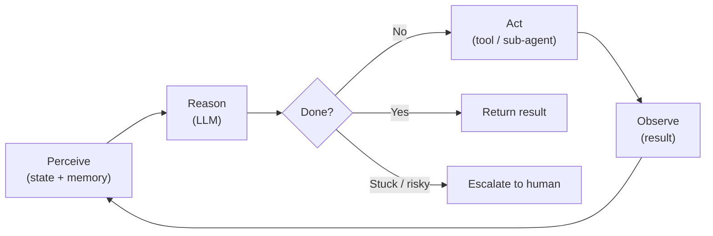
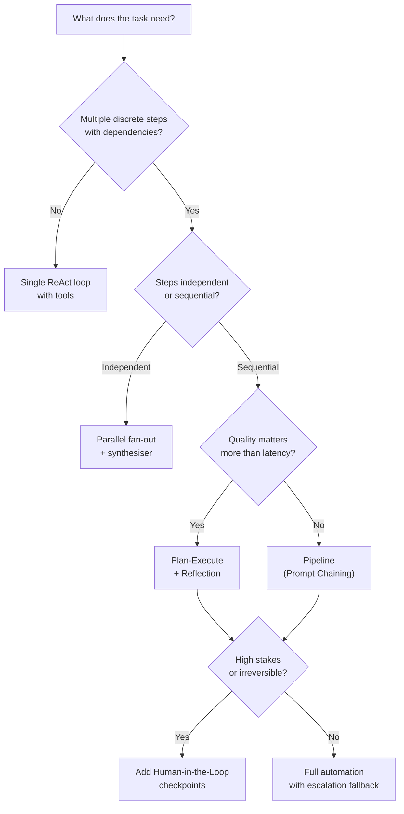

# Agentic Design Patterns 101

An agent is a system that perceives state, reasons about it, takes actions, and observes the consequences — in a loop. It does not stop after one response.

This article introduces the pattern landscape: what agents are, how they behave, which patterns exist, and how to choose between them.

---

## Why This Matters

One-shot prompting solves one-shot problems. Most real engineering tasks are not one-shot:

- Implementing a Jira epic requires reading code, writing a plan, validating assumptions, and revising based on what is discovered.
- Investigating a production incident requires querying multiple systems, forming hypotheses, and testing them.
- Reviewing a large pull request requires reading multiple files, building a mental model, and issuing structured feedback.

Agentic patterns give you a vocabulary for designing systems that can sustain multi-step, tool-using, self-correcting work — reliably and predictably.

---

## The Agentic Loop

Every agent, regardless of pattern, runs a version of this loop:

```
Perceive → Reason → Act → Observe → Perceive → ...
```

1. **Perceive** — take in the current state (task, memory, tool results, history)
2. **Reason** — decide what to do next (or whether the task is complete)
3. **Act** — call a tool, produce output, or hand off to another agent
4. **Observe** — incorporate the result of the action into state

The loop terminates when the agent reaches a goal, hits a budget limit, or escalates to a human.



---

## Pattern Landscape

There are six pattern families. They compose: a real agent will often combine two or three.

| Family | Core idea | Typical use case |
|---|---|---|
| **Core loops** | How the agent reasons and acts within a single task | Tool-using assistants, code generation, research |
| **Prompt chaining** | Sequential LLM calls where output A becomes input B — not an agentic loop | ETL pipelines, document processing, multi-phase workflows |
| **Multi-agent** | Multiple agents with distinct roles, coordinated by an orchestrator | Complex analysis, parallel research, large-scale automation |
| **Memory** | How agents retain and recall information across actions | Long-horizon tasks, personalisation, codebase navigation |
| **Tool use** | How agents interact with external systems | CRUD operations, API calls, code execution |
| **Human-in-the-loop** | How agents hand off to humans and resume | Approval gates, escalation, audit-sensitive operations |

---

## Core Loop Patterns

These govern how a single agent reasons and acts.

### ReAct (Reason + Act)

The agent explicitly reasons before each action. Thought and action interleave:

```
Thought: I need to check the current deployment status.
Action: call_tool("get_deployment_status", {"service": "payments"})
Observation: {"status": "degraded", "since": "14:32 UTC"}
Thought: The service is degraded. I should check recent deployments.
Action: call_tool("list_recent_deployments", {"service": "payments", "limit": 5})
...
```

ReAct is the default starting point for most tool-using agents.

### Plan-Execute

The agent produces a structured plan before taking any action. Execution is a separate phase.

Separation allows:
- Human review of the plan before execution
- Parallelisation of independent plan steps
- Replanning if a step fails

### Reflection

The agent evaluates its own output and revises it. A critic (same or separate model) scores the output and provides structured feedback. The generator revises until quality criteria are met.

---

## Multi-Agent Patterns

These govern how multiple agents collaborate.

### Orchestrator / Worker

A central orchestrator decomposes the task and delegates to specialist workers. Workers return results; the orchestrator aggregates and decides what to do next. The orchestrator does not execute directly — it coordinates.

### Parallel (Fan-out / Fan-in)

Multiple agents run concurrently on independent subtasks. A synthesiser merges the results. Best for tasks with no data dependencies between subtasks.

---

## Prompt Chaining

Prompt chaining is **not** a multi-agent pattern. There is no agentic loop — each stage is a single, stateless LLM call. Output from one stage becomes the input to the next. The chain is deterministic and observable; each step can be tested independently.

It is the simpler predecessor to a multi-agent pipeline. When a stage needs memory, tools, or the ability to iterate, it becomes a full agent and the chain becomes a pipeline.

### Pipeline

Stages are arranged in a sequence. Each stage has a narrow, focused role. A stage can be a plain LLM call (prompt chain) or a full agent. Output flows downstream.

---

## Memory Patterns

Agents have three types of memory:

| Type | Lifetime | Location | Example |
|---|---|---|---|
| **In-context** | One interaction | Context window | Recent tool results, conversation history |
| **External** | Persistent | Vector store, key-value, database | Codebase knowledge, past decisions |
| **Episodic** | Session | Rolling buffer | Prior turns in a long conversation |

Context engineering (the companion series) governs what goes into in-context memory. This series focuses on how agents use and update all three.

---

## Tool Use

Tools ground agents in real-world state. Without tools, agents can only reason about what is in their context. With tools, they can read live data, execute code, call APIs, and persist results.

Every tool call is:
1. **Defined** — schema that tells the model what the tool does and what it expects
2. **Dispatched** — the agent's output triggers execution
3. **Observed** — the result is injected back into context for the next reasoning step

Tool errors are part of the loop. A well-designed agent handles tool failure by reasoning about it, not crashing.

---

## Human-in-the-Loop Patterns

Agents that operate autonomously on high-stakes tasks need human checkpoints. These are not failures of automation — they are designed control surfaces.

| Pattern | When to use |
|---|---|
| **Approval gate** | Before irreversible or high-risk actions |
| **Checkpoint review** | At natural phase boundaries (e.g. after planning, before execution) |
| **Escalation** | When the agent is stuck, uncertain, or detects a conflict it cannot resolve |

---

## Choosing a Pattern

Use this decision guide as a starting point. Patterns compose, so the right answer is often "start with the simplest and add complexity only when needed."



---

## Trade-offs

Every pattern has costs. Choose deliberately.

| Concern | Simpler pattern | More complex pattern |
|---|---|---|
| **Latency** | Lower (fewer round-trips) | Higher (more steps, more tool calls) |
| **Cost** | Lower (fewer tokens) | Higher (multi-agent = multiple LLM calls) |
| **Step-level recoverability** | Lower (single point of failure) | Higher (each step can be retried independently) — though overall system reliability may be lower due to more failure surfaces and coordination overhead |
| **Observability** | Harder (one big black box) | Easier (each step has inputs and outputs) |
| **Debuggability** | Harder | Easier |
| **Development cost** | Lower | Higher |

Start simple. Add complexity only when a simpler pattern provably cannot meet the requirement.

---

## What Comes Next

This series covers each family in depth:

- [Part 2: Core Loops](agentic-patterns-core-loops.md) — ReAct, Plan-Execute, Reflection with Go examples
- [Part 3: Prompt Chaining](agentic-patterns-prompt-chaining.md) — Linear chains, gates, routing, and when not to use a full agent loop
- [Part 4: Multi-Agent Patterns](agentic-patterns-multi-agent.md) — Orchestrator/Worker, parallel, pipeline
- [Part 5: Memory](agentic-patterns-memory.md) — In-context, external, and episodic memory; write-back; shared memory
- [Part 6: Tool Use](agentic-patterns-tool-use.md) — Tool design, error handling, parallel calling, caching, and MCP
- [Part 7: Human-in-the-Loop](agentic-patterns-human-in-the-loop.md) — Approval gates, checkpoints, escalation
- [Part 8: Maersk Lens](agentic-patterns-maersk-lens.md) — Applying patterns to Maersk systems and tooling
