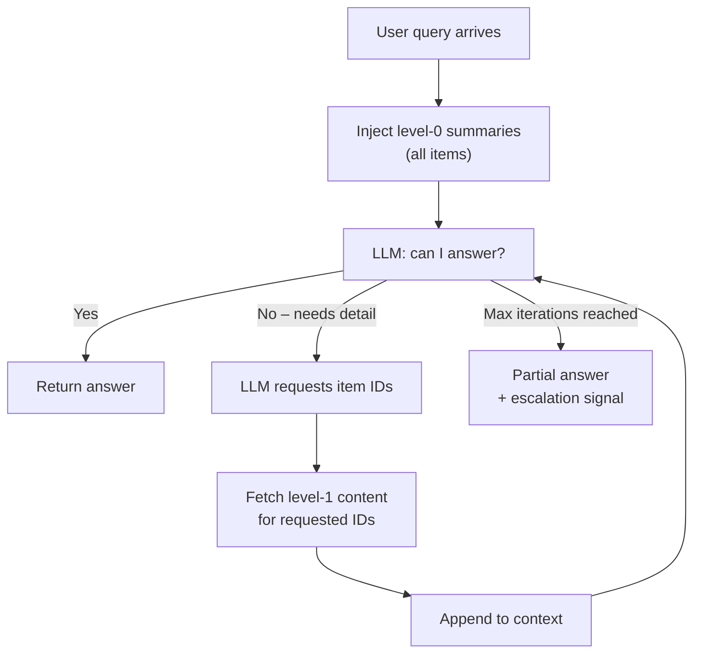

# Context Engineering Part 5: Progressive Disclosure

Context budgeting (Part 4) helps you make the best use of a fixed window. Progressive disclosure addresses the next problem: what happens when the total knowledge space is too large to fit in any budget, no matter how carefully you trim?

This pattern lets the agent start with almost nothing and request only what it actually needs.

---

## The Problem It Solves

Most knowledge-intensive agents draw on many heterogeneous sources: meeting transcripts, chat threads, documentation, code, tickets. Even with aggressive compression, injecting all of this at once:

- Exceeds gateway limits for large knowledge bases
- Forces the agent to read material it will never use
- Increases cost and latency proportionally to knowledge size, not query complexity
- Reduces signal-to-noise ratio in the context window

The usual fix—top-k vector search—helps but is a blunt instrument. Relevance scoring on summaries is reliable; relevance scoring on the right paragraph inside the right document is not.

Progressive disclosure separates these into two distinct steps.

---

## Core Idea

Every knowledge item has two levels:

| Level | Content | Token cost |
|-------|---------|------------|
| **Level 0** | Title, type, date, one-sentence summary | ~20–40 tokens |
| **Level 1** | Full content (transcript, document body, file) | 500–10,000+ tokens |

The agent always starts with level-0 for all available items. If it needs more to answer correctly, it requests specific item IDs for level-1 expansion. Level-1 content is fetched and appended, then the agent reasons again.

This is a **multi-turn retrieval pattern** where the model controls what enters its context rather than a retrieval layer guessing on its behalf.



---

## When to Use It

Progressive disclosure is worth the added complexity when:

- Total knowledge exceeds roughly 2× your usable context window even after compression
- Queries vary widely in scope (some need one document, some need ten)
- Knowledge items have meaningful standalone summaries that support routing decisions
- You are operating in a conversational or agentic loop where latency is acceptable

It is usually overkill for:

- Single-document tasks (just inject the document)
- Tasks where all relevant material is already known at request time
- Batch pipelines where latency matters more than token efficiency

---

## Relationship to Context Budgeting

These two patterns compose. Budget management governs **how much** of any item enters the context window. Progressive disclosure governs **which items** are fetched at all.

A practical stack:

1. **Progressive disclosure** selects which items to include (level 0 → level 1 on demand).
2. **Budget management** trims each included item to fit within its section allocation.
3. **Escalation rules** from Part 4 still apply: if a level-1 item cannot fit after trimming, escalate rather than silently drop it.

---

## Reference Implementation (Go)

The following shows the core loop. Replace `mockLLM` and the inline `expandItem` stub with your real LLM client and document store.

### Data model

```go
type ContentItem struct {
    ID       string
    Type     string // "meeting" | "chat" | "doc" | "code"
    Title    string
    Date     time.Time
    Summary  string // level-0: one sentence
    FullText string // level-1: populated on demand
}

type LLMResponse struct {
    Answer           string           `json:"answer,omitempty"`
    NeedsExpansion   bool             `json:"needs_expansion"`
    ExpansionRequest ExpansionRequest `json:"expansion_request,omitempty"`
}

type ExpansionRequest struct {
    ItemIDs []string `json:"item_ids"`
}
```

### System prompt

Teach the model the protocol once, in the system message:

```go
const systemPrompt = `You are a virtual team member with access to meeting transcripts,
group chats, documentation, and code.

You will first receive only TITLES and ONE-SENTENCE SUMMARIES of available items.

Rules:
- If summaries contain enough information to answer, respond:
  {"answer": "..."}
- If you need the full content of specific items, respond:
  {"needs_expansion": true, "expansion_request": {"item_ids": ["id1", "id2"]}}

You may request expansion more than once. After each expansion, updated content
will be appended to your context. Always answer using the most specific information available.

Output ONLY valid JSON.`
```

### Disclosure loop

```go
func (a *Agent) Ask(ctx context.Context, query string) (string, error) {
    // Start with all level-0 summaries; no full text yet.
    a.resetContext()
    for _, item := range a.knowledge {
        shallow := *item
        shallow.FullText = ""
        a.contextItems = append(a.contextItems, shallow)
    }

    const maxIterations = 3
    for i := range maxIterations {
        messages := []Message{
            {Role: "system", Content: systemPrompt},
            {Role: "user", Content: fmt.Sprintf("%s\n\nQuery: %s", a.renderContext(), query)},
        }

        raw, err := a.llm.Chat(ctx, messages)
        if err != nil {
            return "", fmt.Errorf("iteration %d: %w", i, err)
        }

        var resp LLMResponse
        if err := json.Unmarshal([]byte(raw), &resp); err != nil {
            return raw, nil // treat as plain-text answer
        }

        if !resp.NeedsExpansion {
            return resp.Answer, nil
        }

        if !a.expand(resp.ExpansionRequest.ItemIDs) {
            return "Cannot answer: requested items not found.", nil
        }
    }

    return "Max expansions reached without a final answer.", nil
}
```

### Expansion

```go
func (a *Agent) expand(ids []string) bool {
    expanded := false
    for _, id := range ids {
        item, ok := a.knowledge[id]
        if !ok {
            continue
        }
        if item.FullText == "" {
            item.FullText = a.store.FetchFullText(id) // your document store
        }
        // Update the shallow copy already in contextItems.
        for i := range a.contextItems {
            if a.contextItems[i].ID == id {
                a.contextItems[i].FullText = item.FullText
                expanded = true
            }
        }
    }
    return expanded
}
```

---

## Guardrails

Left unconstrained, the model may over-request (fetching everything) or under-request (missing relevant material). Apply these limits:

| Guardrail | Rationale |
|-----------|-----------|
| **Max iterations** (default 3) | Bounds worst-case latency and cost |
| **Max expansions per turn** (default 5 item IDs) | Prevents the model requesting the entire corpus in one step |
| **Per-item token cap** | Apply Part 4 trimming rules to each level-1 item before injecting |
| **Deduplication** | Track which IDs have already been expanded; refuse re-requests |
| **Staleness check** | Level-0 summaries should carry a `last_updated` timestamp; re-index stale items before a session |

---

## Observability

Instrument the loop so you can tune it:

- `disclosure_iterations_total` – histogram; spikes indicate level-0 summaries are insufficiently descriptive
- `disclosure_expansions_total` – by item type; reveals which sources are over-relied upon
- `disclosure_max_reached_total` – counter; non-zero means some queries need better summaries or a higher iteration cap
- `disclosure_tokens_level0` and `disclosure_tokens_level1` – compare to understand actual savings vs a naive approach
- Log the final set of expanded item IDs per session for audit and tuning

---

## Writing Good Level-0 Summaries

The whole pattern depends on level-0 summaries being useful for routing. A poor summary makes the model guess wrong or over-request.

Good level-0 summaries:

- State the **decision or outcome**, not just the topic ("Team agreed to adopt OAuth2 for external clients")
- Include **named entities** that may appear in user queries (systems, people, dates)
- Note **open questions or conflicts** so the model knows to request the full item when relevant
- Are one to two sentences maximum

Poor level-0 summaries:

- Describe format rather than content ("Minutes from the auth meeting on 1 March")
- Are too vague to distinguish items ("Discussion about security")
- Are generated by a model without access to the full item (circular: you need the content to summarise it well)

For initial indexing, use a small model or extractive approach: take the first substantive paragraph and the conclusion or action items. Re-summarise with full content available.

---

## Tradeoffs at a Glance

| Factor | Progressive disclosure | Flat top-k retrieval |
|--------|------------------------|----------------------|
| Token cost (small query) | Very low – mostly level-0 | Medium – fixed top-k chunks |
| Token cost (complex query) | Higher – multiple expansions | Fixed regardless of complexity |
| Latency | Higher – 2–4 round trips | Single round trip |
| Recall control | Model-driven, explicit | Embedding-similarity driven |
| Debuggability | High – expanded IDs are logged | Medium – chunk provenance varies |
| Summary quality dependency | High | Low |

---

## Deliverables Checklist

- [ ] Level-0 summary field on every knowledge item (generated at index time, not query time)
- [ ] System prompt defining the expansion protocol
- [ ] Expansion loop with `max_iterations` and `max_expansions_per_turn` limits
- [ ] Per-item token cap wired to the Part 4 budget policy
- [ ] Deduplication: expanded item IDs tracked per session
- [ ] Metrics for iterations, expansions, and max-reached events

---

## Related Pages

- [Context engineering 101](context-engineering.md)
- [Part 2 - Maersk lens](context-engineering-maersk-lens.md)
- [Part 3 - practical Go example](context-engineering-go-example.md)
- [Part 4 - advanced context budgeting](context-engineering-context-budget-advanced.md)
