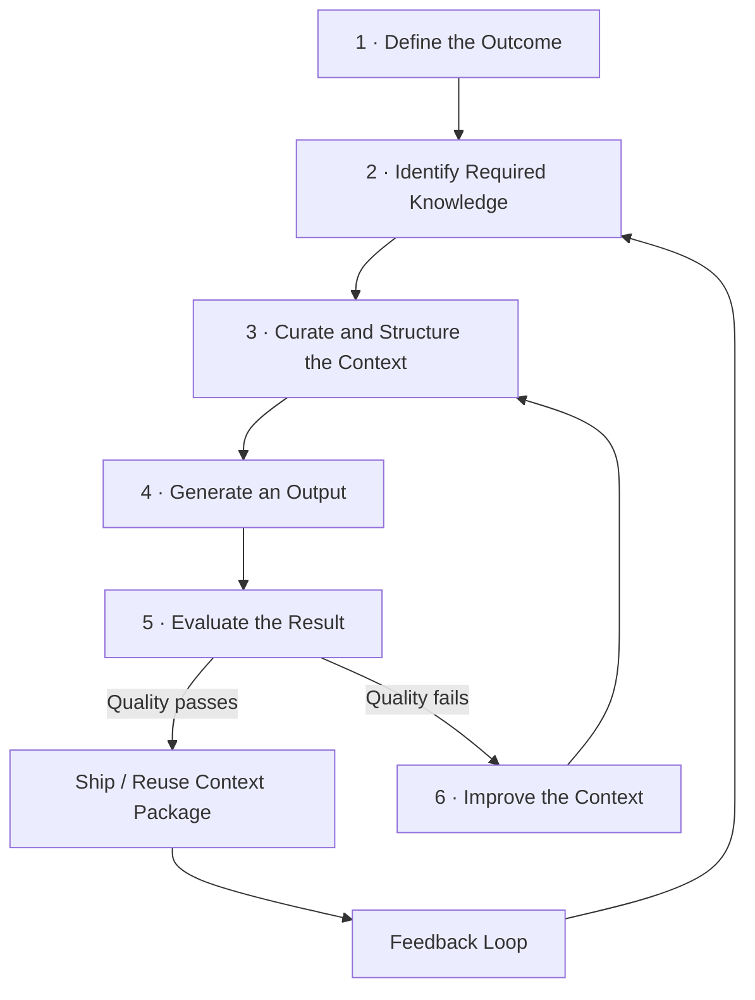

# Context Engineering 101

Context engineering is the practice of giving an AI system the right information, in the right shape, at the right time, so it can produce useful, reliable output.

If prompt engineering is "how you ask," context engineering is "what the AI knows when it answers."

---

## Why This Matters

Most poor AI results are not caused by a weak model. They are caused by weak context:

- Missing business rules
- Missing system constraints
- Stale or conflicting information
- No examples of what "good" looks like

When context is engineered well, output quality improves quickly and becomes more repeatable across teams.

---

## The Basic Mental Model

Think in this sequence:

1. **Task** - What exact outcome do we need?
2. **Context** - What knowledge is required to do that safely and correctly?
3. **Format** - How should the result be structured?
4. **Verification** - How do we know the result is correct?
5. **Feedback** - How do we improve the context after each run?

The model is only one part of the system. Context quality determines whether the model can perform well on real work.



---

## What Counts as "Context"?

Context is not only a long prompt. It includes:

- **Instructions:** objective, audience, scope, and boundaries
- **Reference material:** docs, tickets, architecture notes, runbooks, and policies
- **Examples:** approved outputs, templates, and prior high-quality work
- **Constraints:** compliance, style, tooling, and technical limitations
- **Live state:** current code, open tasks, incidents, and recent decisions
- **Evaluation criteria:** definition of done, quality checks, and failure conditions

---

## High-Level Context Engineering Process

Use this as a simple operating loop.

### 1) Define the Outcome

Write a one-sentence success condition.  
Example: "Produce a rollout plan for feature X that includes risk controls and owner handoffs."

### 2) Identify Required Knowledge

List only what is needed for this task:

- System boundaries
- Relevant policies
- Known constraints
- Source-of-truth documents

Avoid dumping every document into the prompt.

### 3) Curate and Structure the Context

Turn raw information into a usable context package:

- Short task brief
- Key facts and constraints
- 1-3 representative examples
- Expected output format
- Checks the AI must pass before finalizing

### 4) Generate an Output

Run the task with the curated package. Prefer deterministic structure (headings, bullet patterns, schemas) over open-ended output.

### 5) Evaluate the Result

Score quality against a rubric:

- Correctness
- Completeness
- Policy compliance
- Practical usefulness

### 6) Improve the Context

If output is weak, improve context first (missing facts, unclear constraints, poor examples) before changing models.

---

## How To Get Started (Week 1)

Start small with one repeatable workflow.

1. Pick one task done at least weekly.
2. Write a one-page context brief for that task.
3. Add two strong examples (good output and bad output).
4. Define a 5-point quality checklist.
5. Run 5-10 trials and track failure patterns.
6. Update context artifacts based on those patterns.

If you cannot explain why an output failed, your context package is still too vague.

---

## Common Mistakes

- Treating context as a one-time prompt instead of a managed asset
- Including too much data with no prioritization
- Omitting constraints and then blaming the model
- No quality rubric (result is judged by "feel")
- No feedback loop from real usage

---

## Practical Deliverables

A minimal context engineering setup usually includes:

- Task brief template
- Context source list
- Reusable examples library
- Quality rubric/checklist
- Change log for context updates

These artifacts create consistency across people, models, and use cases.

### Recommended Folder Structure

One directory per repeatable workflow. Each maps directly to the five deliverables above and mirrors a test suite: spec → fixtures → assertions → change log.

```
context/
├── _template/                              # Copy this to bootstrap any new workflow
│   ├── brief.md                            # Objective, audience, definition of done
│   ├── sources.md                          # Authoritative sources and freshness rules
│   ├── examples/
│   │   ├── good/                           # Approved outputs with inline annotations
│   │   └── bad/                            # Failure examples with notes on what went wrong
│   ├── rubric.md                           # Quality checklist the AI must pass
│   └── changelog.md                        # Dated log of every context update and why
├── incident-triage/
│   ├── brief.md
│   ├── sources.md
│   ├── examples/
│   │   ├── good/
│   │   │   └── mtts-mss-tls-2026-04-03.md # Full root-cause chain with traced evidence
│   │   └── bad/
│   │       └── premature-conclusion.md     # Diagnosis with no evidence trail
│   ├── rubric.md
│   └── changelog.md
├── sprint-planning/
│   └── ...
└── README.md                               # What workflows exist, who owns them, how to add one
```

A few design choices worth noting:
- `examples/` uses `good/` and `bad/` subdirectories so each can grow independently — one flat file per category doesn't scale.
- Filenames describe the case, not the role. The directory already tells you whether it is a positive or negative example.
- `changelog.md` makes the feedback loop concrete — every time a trial reveals a gap, record what changed and why.
- The whole `context/` tree belongs in version control alongside the code it supports.

---

## Next Step: Maersk Lens

This guide stays tool-agnostic on purpose. The next layer will adapt this process to Maersk sources of truth, including:

- Jira (work state, issue context, delivery intent)
- Confluence (decisions, architecture, process docs)
- GitHub (code truth, PR history, implementation details)

That extension should define what to pull from each source, when to trust it, and how to reconcile conflicts.

See Part 2: [Context engineering Part 2 - Maersk lens](context-engineering-maersk-lens.md).
